<div align="center">


<br />

### Stop picking up your phone. 📵

**Calls, WhatsApp & SMS, OTPs, photos, the camera as a webcam and every app, right on your Windows PC.<br />Print and scan from the phone, one mouse and keyboard for two PCs, files to any PC, phone or TV.<br />All over your own Wi-Fi: no cloud, no account, no cables.**

<br />

[](https://github.com/lalitaryan1993/dropwave/releases/latest)
&nbsp;
[](https://github.com/lalitaryan1993/dropwave/releases/latest)

[](https://github.com/lalitaryan1993/dropwave/releases)
[](https://github.com/lalitaryan1993/dropwave/releases)
[](https://github.com/lalitaryan1993/dropwave/stargazers)
[](LICENSE)


<br />

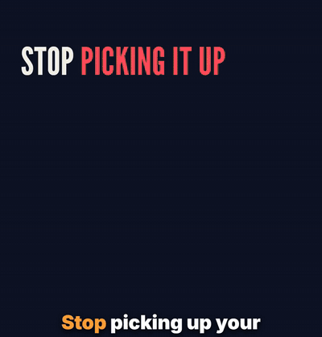

<sub>Real DropWave screens with a demo phone (made-up names and numbers)</sub>

</div>

---

## ✨ Everything your phone does, on your PC

<table>
<tr>
<td width="33%" valign="top">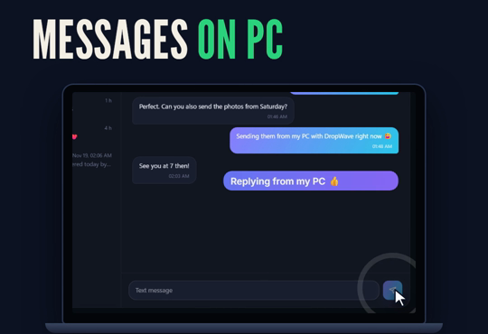<br /><b>💬 Messages</b><br />WhatsApp and other notifications with <b>Reply</b>, and your SMS conversations. Read and answer from the keyboard.</td>
<td width="33%" valign="top"><br /><b>🔢 OTP in one click</b><br />A bank code arrives, you press <b>Copy code</b>. The phone stays in your pocket.</td>
<td width="33%" valign="top"><br /><b>📞 Calls</b><br />A popup on top of everything: <b>Answer</b>, <b>Decline</b>, <b>Silence</b>, reply with a message, then <b>Mute</b> and <b>Speaker</b>. SIM and WhatsApp calls.</td>
</tr>
<tr>
<td width="33%" valign="top">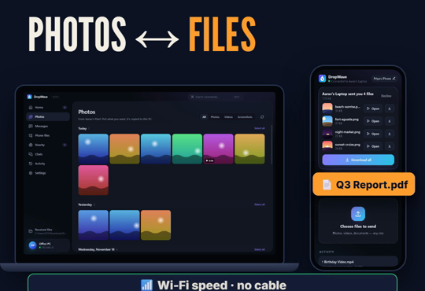<br /><b>🖼️ Photos ↔ files</b><br />The camera roll on the PC, phone storage, drag & drop both ways and <b>photo auto-backup</b>. Originals, at Wi-Fi speed.</td>
<td width="33%" valign="top"><br /><b>📷 Phone = webcam</b><br />Pick <b>DropWave Camera</b> in Zoom, Meet or Teams (Windows 11). Front or back camera, torch, mirror.</td>
<td width="33%" valign="top"><br /><b>📱 Apps & contacts</b><br />Every app with its icon (open, info, uninstall, copy APK, recent and most used), contacts and call history.</td>
</tr>
<tr>
<td width="33%" valign="top">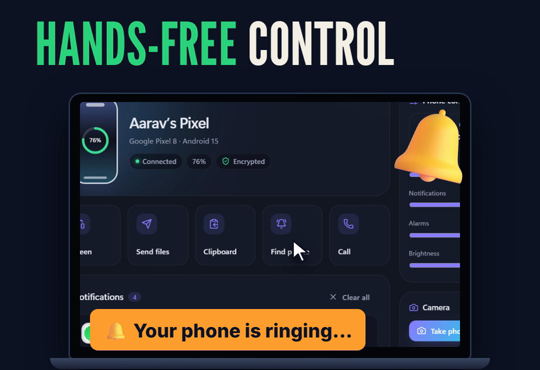<br /><b>🔦 Phone controls</b><br />Torch, Do Not Disturb, volumes, brightness, lock. Lost it under the sofa? <b>Find phone</b> rings it, even on silent.</td>
<td width="33%" valign="top">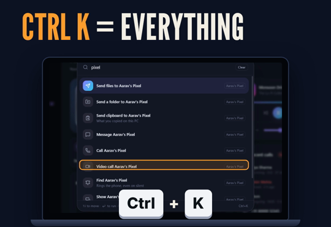<br /><b>⌨️ Ctrl + K</b><br />One search box for everything: send a file, call, message, find the phone, switch theme or language.</td>
<td width="33%" valign="top"><br /><b>🔒 Stays on your Wi-Fi</b><br />Scan a QR code once. No cloud, no account, no login. Encrypted, and a switch for every feature on the phone.</td>
</tr>
</table>

**And more:** clipboard both ways (and a *Send clipboard* tile on the phone) · music and volume · works while the phone is locked · **Hindi** and English · five styles in light and dark.

<p align="center">
  <br />
  <sub><b>Safe by default:</b> when a bank or UPI app opens on the phone, control from the PC switches itself off.</sub>
</p>

## 🆕 Print, scan, and one mouse for two PCs

<table>
<tr>
<td width="25%" valign="top">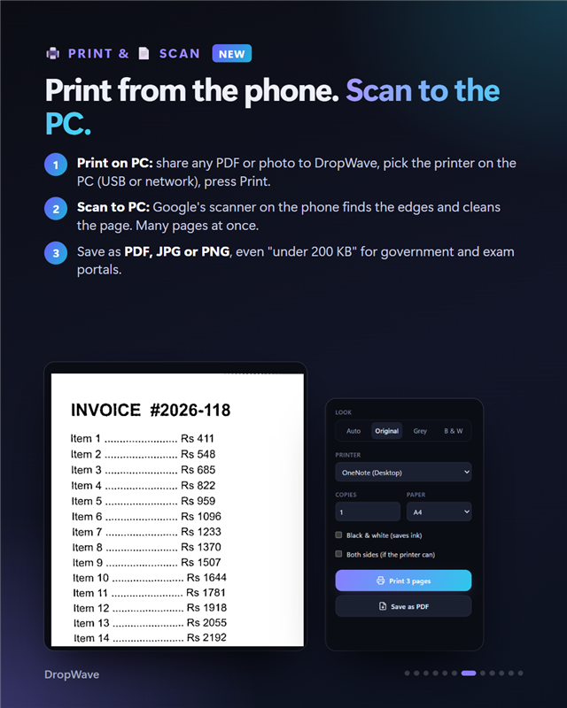<br /><b>🖨️ Print & 📄 scan</b><br />Share a PDF or photo to DropWave and print it on any printer the PC can use. Scan pages with Google's document scanner on the phone; save as <b>PDF, JPG or PNG</b>, even under 200 KB for portals.</td>
<td width="25%" valign="top">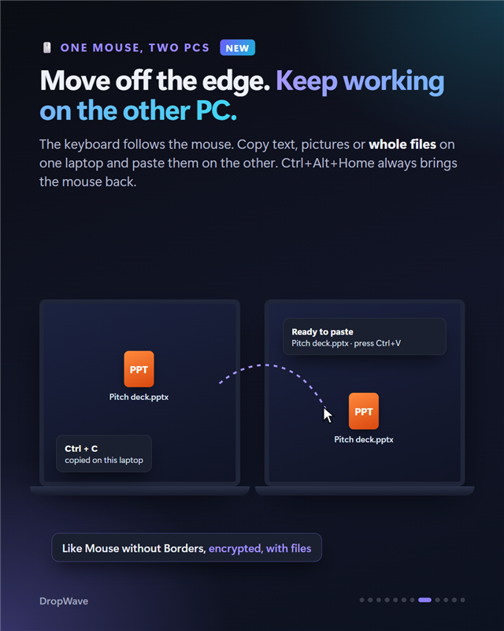<br /><b>🖱️ One mouse, two PCs</b><br />Push the pointer off the edge of the screen and keep working on the other PC. The keyboard follows; copy text, pictures or <b>whole files</b> on one and paste on the other.</td>
<td width="25%" valign="top"><br /><b>🌍 Nearby, in 3D</b><br />Your PC is a turning globe; PCs, phones and TVs circle it. Drop files on one, or click it for files, chat, calls and screen sharing.</td>
<td width="25%" valign="top"><br /><b>🪟 Apps in PC windows</b><br />Any phone app in its own window, over USB or Wireless debugging. Banking and UPI apps never show on the PC.</td>
</tr>
</table>

## 💻 PC ↔ PC, phone screen, calls and your TV

DropWave started as the fastest way to move files around the house, and it does a lot more between your devices:

<table>
<tr>
<td width="33%" valign="top">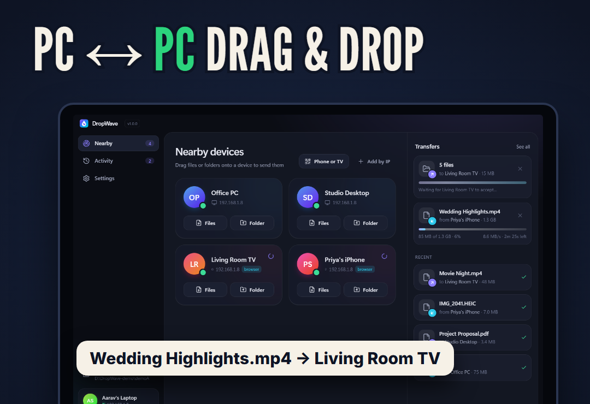<br /><b>💻 PC ↔ PC drag & drop</b><br />PCs on the network find each other. Drop files <b>or whole folders</b> on a device card. No size limit, original quality.</td>
<td width="33%" valign="top">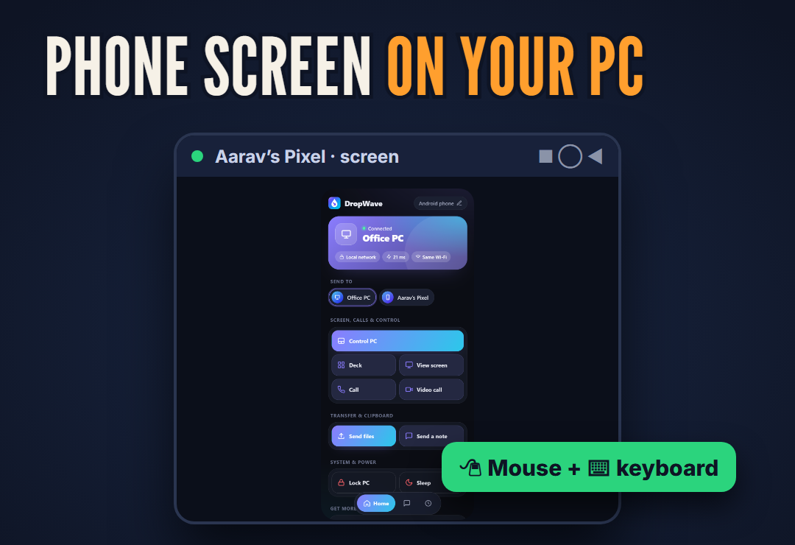<br /><b>📱 Phone screen on your PC</b><br />See the phone's screen in a window and use it with your <b>mouse and keyboard</b>: click, scroll, type, Back / Home, with the phone's sound.</td>
<td width="33%" valign="top"><br /><b>🎥 Video calls + screen share</b><br />Voice and video calls between PCs and phones. Share your screen, or ask to see another PC's screen, and talk while you work.</td>
</tr>
<tr>
<td width="33%" valign="top"><br /><b>🖱️ Remote control, with Allow</b><br />Drive another PC's mouse and keyboard from a PC or from your phone. It asks first, shows who is in control, and <b>Stop</b> ends it.</td>
<td width="33%" valign="top">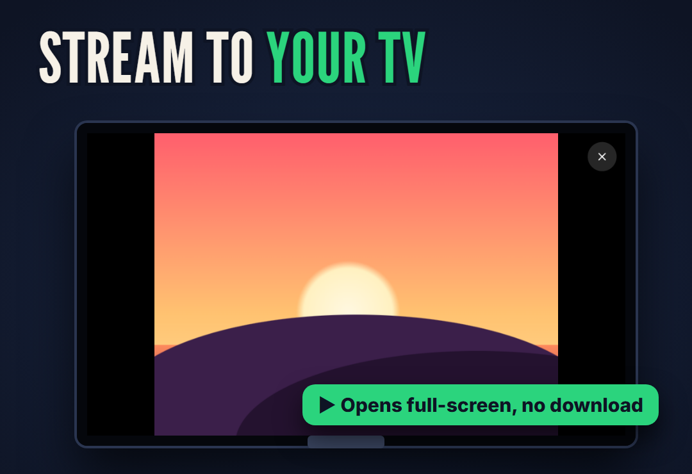<br /><b>📺 Stream to your TV</b><br />Open the TV's browser, scan or type the address once. Photos and videos open <b>full-screen</b>, no download, with big remote-friendly buttons.</td>
<td width="33%" valign="top"><br /><b>▶️ Play before you accept</b><br />Got a 4 GB video? Hit <b>Play</b> in the Accept dialog: it streams from the sender, with seeking, while you decide whether to keep it.</td>
</tr>
<tr>
<td width="33%" valign="top">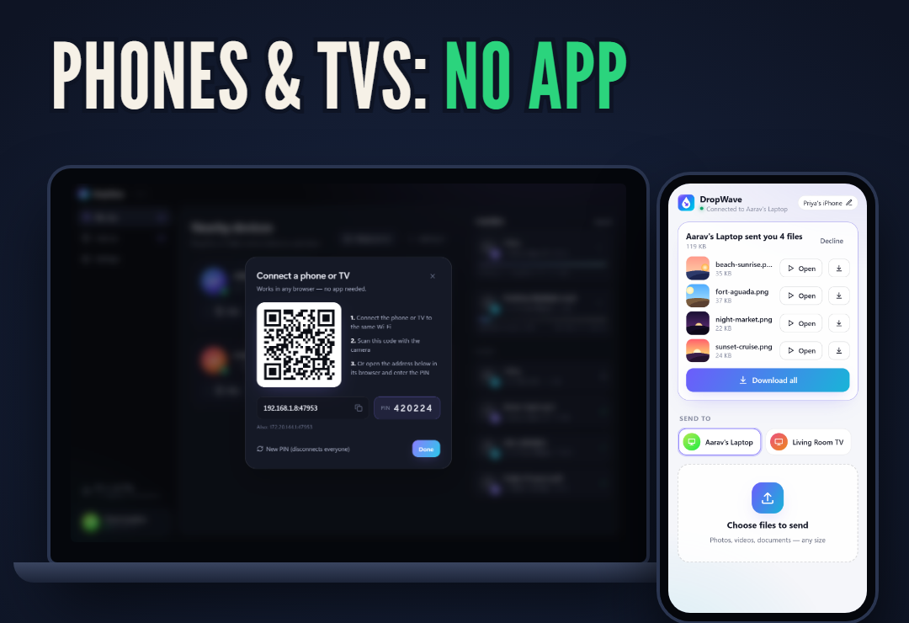<br /><b>🔗 Phones, iPhones & TVs: no app</b><br />Click <b>Phone or TV</b>, scan the QR code, enter the PIN. Any browser can send and receive, phone ↔ phone and phone ↔ TV too.</td>
<td width="33%" valign="top">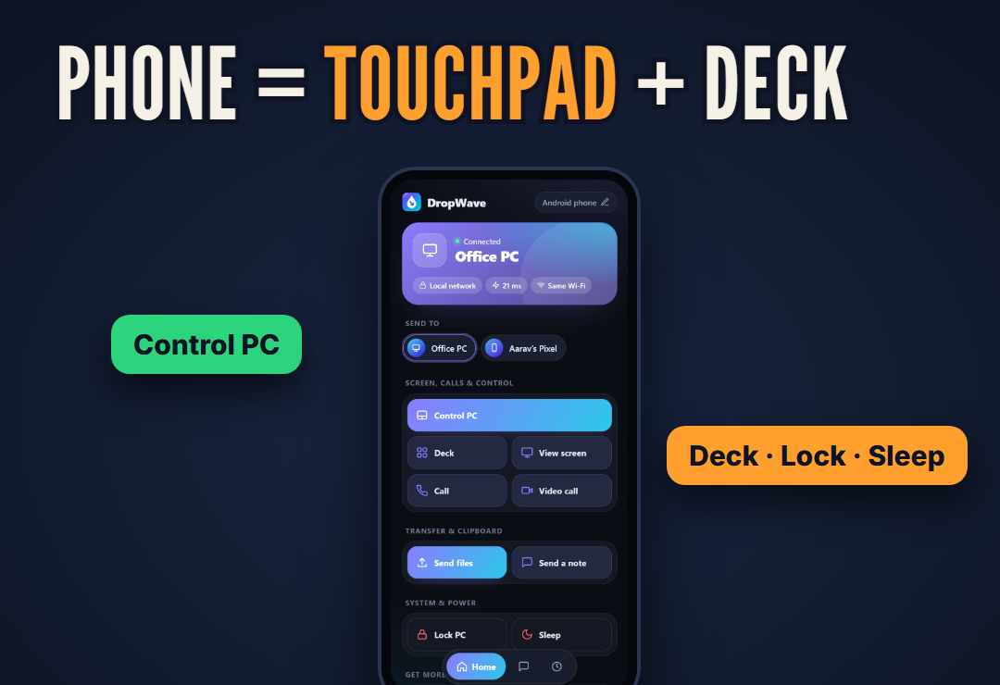<br /><b>🎛️ Phone = touchpad + Deck</b><br /><b>Control PC</b> turns the phone into a touchpad and keyboard, and the <b>Deck</b> gives media, volume, slides, Lock and Sleep buttons.</td>
<td width="33%" valign="top">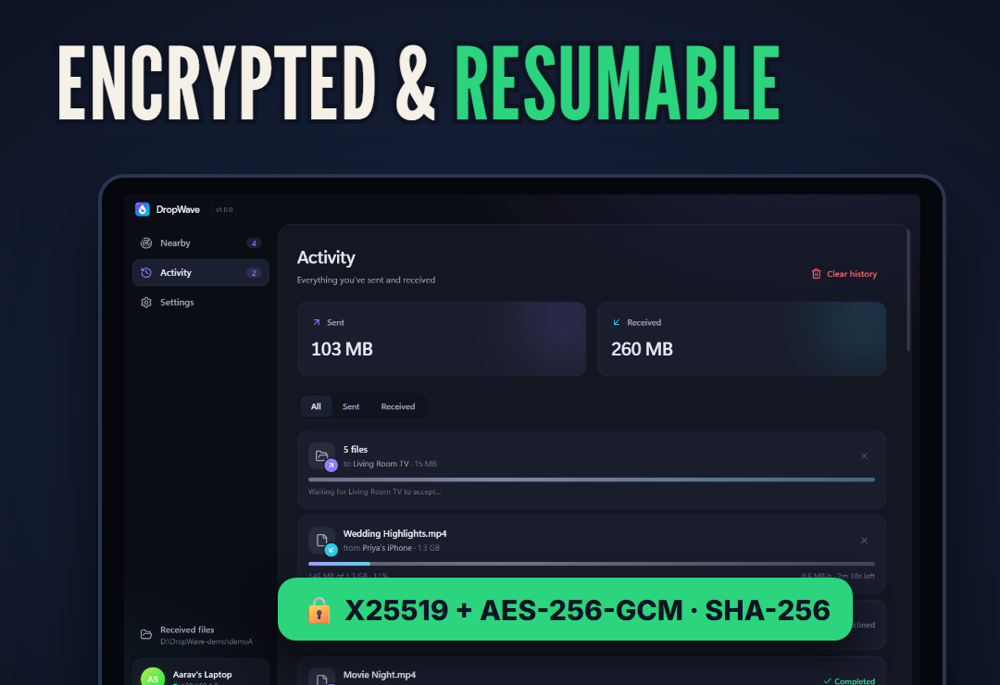<br /><b>🔒 Encrypted & resumable</b><br />PC-to-PC is end-to-end encrypted (X25519 + AES-256-GCM). Wi-Fi dropped? It resumes from the last byte, SHA-256 checked.</td>
</tr>
</table>

**Also:** 💬 chat with any device (links, notes, clipboard) · right-click **Send with DropWave** in File Explorer · one-click **network check** · Accept / Decline for every transfer · **auto-update**.

## 🚀 Get started in 2 minutes

1. **PC:** download **`DropWave-Setup-x.y.z.exe`** from the [latest release](https://github.com/lalitaryan1993/dropwave/releases/latest) and run it.<br />
   <sub>Windows may say *"Windows protected your PC"* because the app isn't code-signed yet: **More info → Run anyway**.</sub>
2. **Phone:** install **`DropWave-Android-x.y.z.apk`** from the same release (Android 10+). It finds your PC on the Wi-Fi by itself; enter the PIN shown on the PC once.
3. On the phone, open **Privacy** and turn on what you want to share. Android asks once for each permission. That's it.
4. **More PCs?** Install DropWave on each one and they find each other. **TVs and iPhones** need nothing: click **Phone or TV** on the PC and scan the QR code.

> Phone and PC must be on the **same Wi-Fi**. No internet is needed. iPhones and smart TVs can still send and receive files from the browser, no install (see below).

## 🆕 New in 1.9

- **🎙️ Phone as the PC's microphone**: press *Use as mic* on Home. With the free [VB-CABLE](https://vb-audio.com/Cable/) it's a mic in Zoom, Meet, Discord and OBS (pick *CABLE Input* in DropWave, *CABLE Output* in the app).
- **🔌 USB cable connection** (*Settings › Phones & TVs*): works when the Wi-Fi is slow or missing. DropWave downloads Google's adb tool for you if needed.
- **🪟 Phone apps in their own PC windows**, with touch and typing, over USB or **without a cable** (Wireless debugging, paired once with a code).
- **🔢 Smart OTP**: new one-time codes are copied to the PC clipboard and cleared after a minute.
- **📲 Phone app**: remembers every PC address (home, office, Tailscale), *Lock PC* tile, home-screen widget. Install an APK from the PC over USB.

<sub>1.8: phone as webcam, call popup, Hindi, contacts, apps, phone controls, styles. [All releases →](https://github.com/lalitaryan1993/dropwave/releases)</sub>

## 🆕 New since 1.9 (in the next release)

- **🖨️ Print on PC**: share any PDF or photo to DropWave on the phone (or *Home › Print & scan*), pick a printer on the PC (USB or network), copies, paper, black & white, both sides. Nothing prints until you press Print on the PC.
- **📄 Scan to PC**: Google's on-device document scanner (live edges, auto capture, clean-up, many pages); the PC can start it too (*Camera › Scan document*). Edit on the PC: Magic / Auto / Grey / B&W, brightness, contrast, sharpness, straighten, crop, page order. Save as **PDF, JPG or PNG**, with size limits for portals.
- **🖱️ One mouse, two PCs** (*Settings › One mouse, two PCs*): mouse and keyboard move to the other PC at the screen's edge; text, pictures and files copied on one PC paste on the other; **Ctrl+Alt+Home** brings the mouse back.
- **🌍 Nearby in 3D**: a turning globe with your devices on an orbit (the card grid is one click away).
- **🛡️ Safer**: banking and UPI apps stop screen sharing and never open in a PC window; "Your PC is controlling this phone" notice with Stop; a scam warning in English and Hindi.
- **✨ A new-look installer**.

## 📋 Complete feature list

<details open>
<summary><b>📱 Your Android phone on your Windows PC</b></summary>

- **Notifications** from every app (WhatsApp, Telegram, Gmail…) on the PC, with **Reply** from the keyboard; dismiss them from the PC.
- **SMS**: read conversations and send texts from the PC.
- **OTP**: *Copy code* in one click; **Smart OTP** copies new codes by itself and clears them after a minute.
- **Calls**: a popup on top of every window for SIM and WhatsApp calls: Answer, Decline, Silence, decline with a message, then Mute, Speaker and Hang up. Call or text any contact; call history.
- **Phone screen on the PC** (screen mirroring) with mouse and keyboard control and the phone's sound; drop files onto it.
- **Phone apps in their own PC windows** (USB cable or Wireless debugging, no cable).
- **Photos**: the camera roll by day, originals; **photo auto-backup** by year and month. **Phone files**: browse and copy.
- **Apps**: open, info, uninstall, copy the APK, recent and most used; install an APK from the PC over USB.
- **Contacts**: search, call, message.
- **Phone as webcam**: *DropWave Camera* in Zoom, Meet, Teams (Windows 11); front or back camera, torch, mirror. Take a photo or record a video on the phone from the PC.
- **Phone as microphone** for the PC (any app with the free VB-CABLE).
- **Phone controls**: torch, Do Not Disturb, volumes, brightness, lock, Wi-Fi and Bluetooth (over USB); **Find phone** rings it even on silent.
- **Clipboard** both ways, a *Send clipboard* tile, music controls, battery, *Lock PC* tile, home-screen widget.
- **Print on PC** and **Scan to PC** (see above).
</details>

<details>
<summary><b>💻 Between your PCs, phones and TVs</b></summary>

- **Drag & drop files and folders** between PCs, no size limit, original quality, end-to-end encrypted, resumable.
- **One mouse and keyboard for two PCs**, with copy and paste of text, pictures and files.
- **Voice and video calls, screen sharing**, and **remote control** (asks first) between PCs and phones.
- **Phones, iPhones and smart TVs from the browser**: scan a QR code, no app needed. Stream photos and videos to the TV; **Play now** before you accept a big video.
- **Control the PC from the phone**: touchpad, keyboard and a **Deck** of shortcuts (media, volume, slides, lock, sleep).
- **Chat** with any device; right-click **Send with DropWave** in File Explorer.
</details>

<details>
<summary><b>🔒 Privacy, safety and comfort</b></summary>

- **No cloud, no account**: your own Wi-Fi, a phone hotspot or a USB cable. TLS 1.3 with a pinned certificate to the phone; X25519 + AES-256-GCM between PCs.
- **A switch for every feature** on the phone; pause everything in one tap.
- **Bank and UPI guard**: control from the PC switches off, screen sharing stops, and banking apps never open in a PC window.
- **Scam safety**: "Your PC is controlling this phone" with Stop, and a warning in English and Hindi.
- **Works while the phone is locked**; battery steps for Realme, Oppo, Vivo, iQOO, Xiaomi, Samsung, OnePlus and Motorola.
- **English and हिन्दी**, five styles in light and dark, **Ctrl + K** for everything, auto-update.
</details>

## 🧩 One app instead of five

DropWave covers what you would otherwise need several apps for:

| You want to… | Usually you'd use | In DropWave |
|---|---|---|
| Use your Android phone on a Windows PC (messages, calls, notifications) | Microsoft Phone Link, KDE Connect, AirDroid | ✅ Free, any Android brand, no Microsoft account |
| Use one mouse and keyboard for two PCs | Mouse without Borders, Synergy, Input Leap | ✅ With copy and paste of files |
| Scan documents to PDF | CamScanner, Adobe Scan, Google Drive scan | ✅ Straight onto the PC, PDF / JPG / PNG |
| Print from the phone | Printer apps, emailing the file to yourself | ✅ Any printer the PC can use |
| Send big files between PC, phone and TV | ShareIt, LocalSend, Nearby Share, pen drives | ✅ Encrypted, no size limit, TVs from the browser |
| Phone camera as a webcam | DroidCam, Iriun | ✅ Built in (Windows 11) |

## 🤔 Why DropWave?

|  | DropWave | Cloud drives / chat apps | USB cable / pen drive |
|---|:---:|:---:|:---:|
| Calls, messages and OTPs on the PC | ✅ | ❌ | ❌ |
| Works without internet | ✅ | ❌ | ✅ |
| Original quality, any file size | ✅ | ❌ compressed / size caps | ✅ |
| Phones & TVs without installing anything | ✅ | ⚠️ app needed | ❌ |
| Your data stays at home | ✅ | ❌ | ✅ |
| Free and open source | ✅ | ⚠️ | ✅ |

<details>
<summary><b>📸 More screenshots</b></summary>
<br />

<table>
<tr>
<td width="50%"><br /><sub>Home: battery, music, notifications with Reply and Copy code, recent calls</sub></td>
<td width="50%">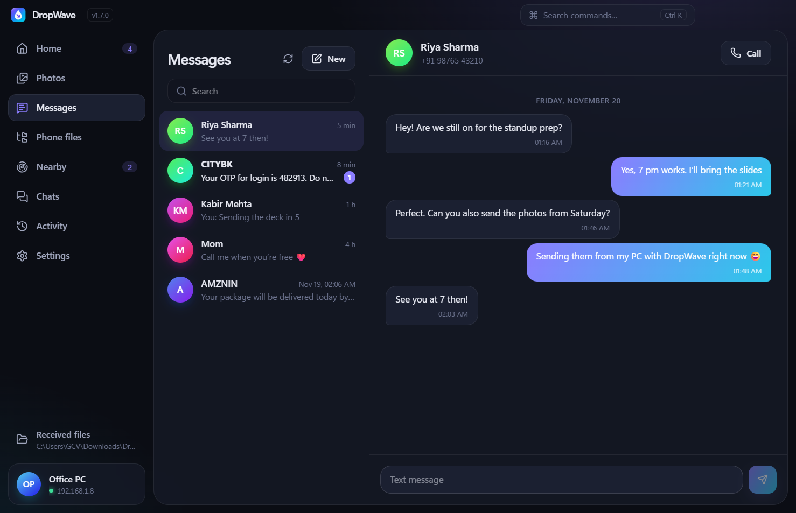<br /><sub>Messages: SMS conversations on the PC</sub></td>
</tr>
<tr>
<td width="50%">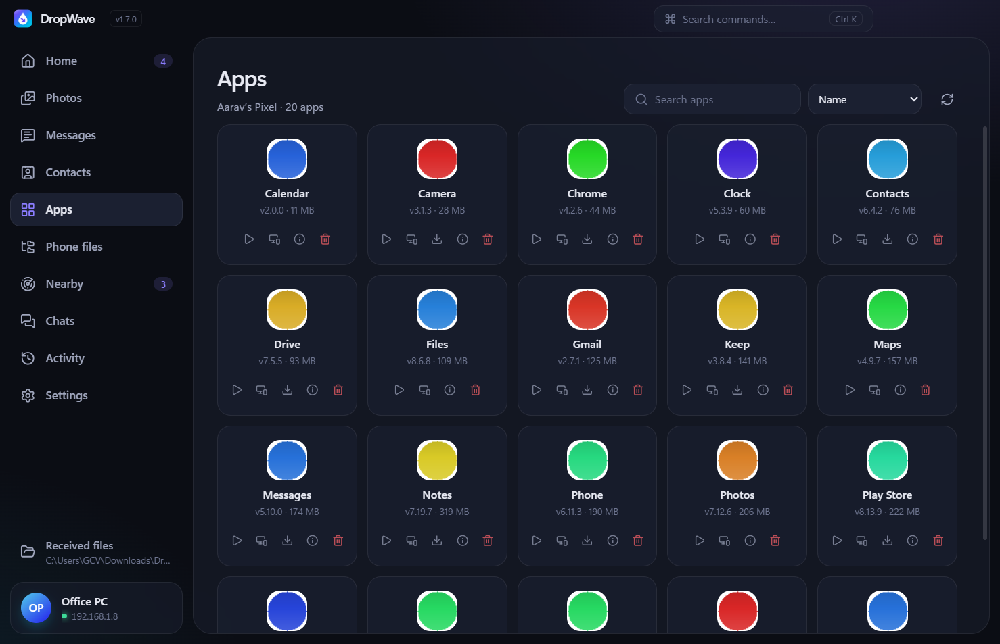<br /><sub>Apps: open, window, APK, info, uninstall</sub></td>
<td width="50%"><br /><sub>Contacts: search, call, message</sub></td>
</tr>
<tr>
<td width="50%">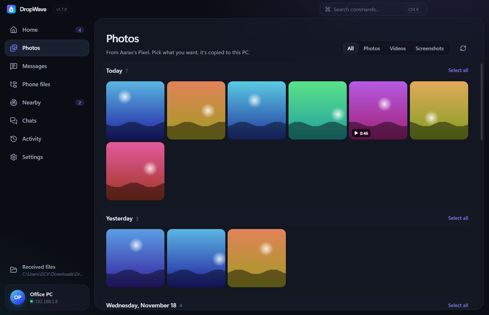<br /><sub>Photos: the camera roll by day</sub></td>
<td width="50%">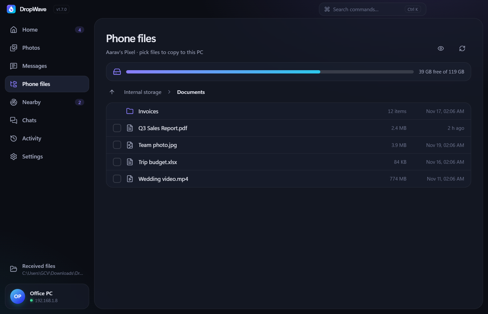<br /><sub>Phone files: browse and copy to the PC</sub></td>
</tr>
<tr>
<td width="50%">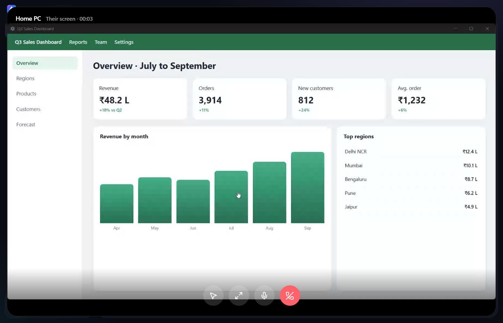<br /><sub>Screen sharing with control, mic and full screen</sub></td>
<td width="50%"><br /><sub>Play now: watch before you accept</sub></td>
</tr>
<tr>
<td width="50%">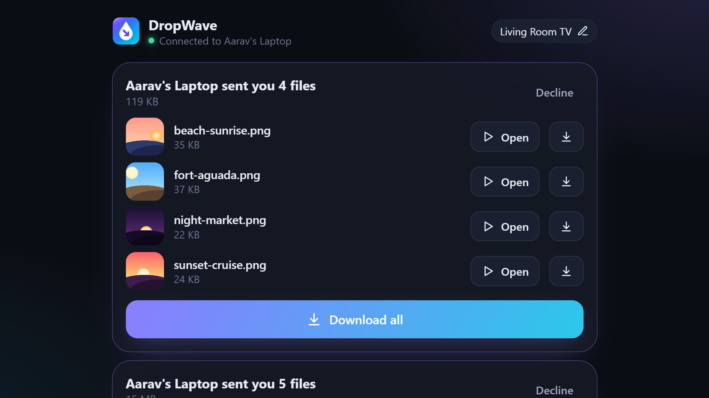<br /><sub>On a smart TV: big, remote-friendly buttons</sub></td>
<td width="50%">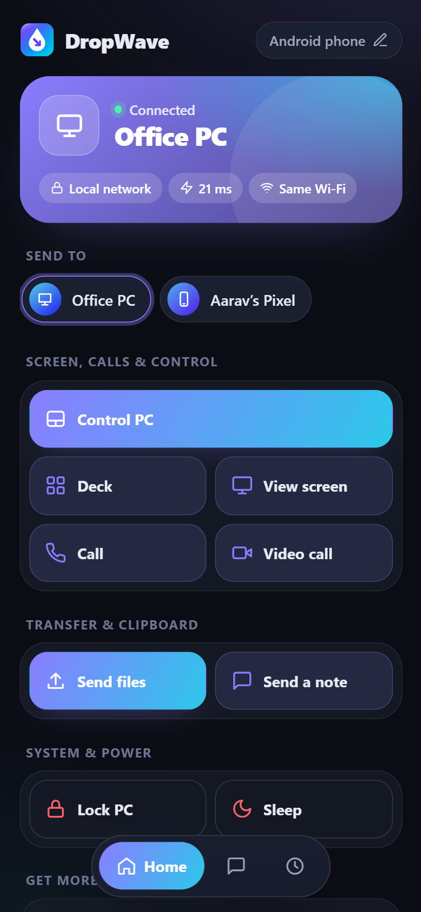<br /><sub>The Android app: Control PC, Deck, calls, send files</sub></td>
</tr>
</table>

<p align="center">
  
  
  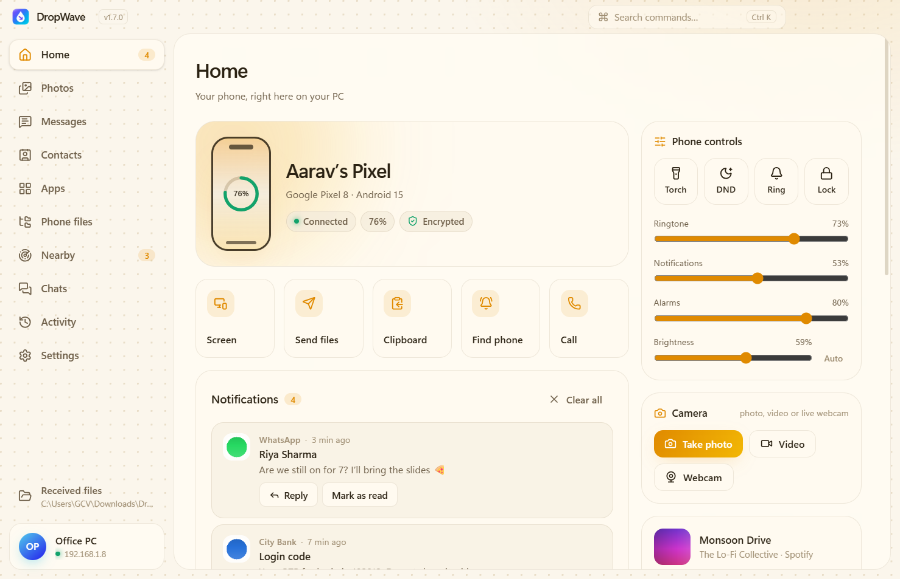
</p>

</details>

## ❓ FAQ

<details>
<summary><b>Is it really free? What's the catch?</b></summary>
It's free and open source under the MIT licence. There is no server, so there is nothing to pay for and nothing that sees your data.
</details>

<details>
<summary><b>Which phones work?</b></summary>
Any Android 10+ phone, any brand. Some brands (Realme, Oppo, Vivo, iQOO, Xiaomi, Samsung, OnePlus, Motorola) stop apps in the background; the phone app shows the one setting to allow for your brand. iPhones can send and receive files from the browser.
</details>

<details>
<summary><b>How do I use one mouse and keyboard for two PCs?</b></summary>
Install DropWave on both PCs (same Wi-Fi). On the PC whose mouse you use: <i>Settings › One mouse, two PCs</i>, turn it on, pick the other PC and say whether it is on the left or the right. The other PC asks once to allow it. Then push the pointer off that edge of the screen. Copy something first (text, a picture or files in File Explorer) and paste it on the other PC. <b>Ctrl+Alt+Home</b> always brings the mouse back.
</details>

<details>
<summary><b>How do I print from my phone, or scan a document to PDF?</b></summary>
On the phone: <i>Home › Print & scan</i>. <b>Print on PC</b> sends a PDF or photo to a print window on the PC (or use <i>Share › DropWave › Print on PC</i> from any app). <b>Scan to PC</b> opens Google's document scanner; the pages open on the PC, where you can clean them up, print them, or save a PDF, JPG or PNG (with "under 200 KB / 500 KB / 1 MB" for upload portals).
</details>

<details>
<summary><b>Can I talk on a call through the PC's headphones?</b></summary>
Not yet. You answer, mute and hang up from the PC, but the voice stays on the phone: Android doesn't let apps carry call audio.
</details>

<details>
<summary><b>Is it safe? Can others on my Wi-Fi get in?</b></summary>
Every device needs your PIN once, and every file asks <b>Accept</b> first. PC-to-PC traffic is end-to-end encrypted (a fresh X25519 key exchange per connection, AES-256-GCM, each PC's Ed25519 identity pinned). The Android app talks to the PC over TLS 1.3 and pins the PC's certificate. The phone has a switch for every feature, and control from the PC turns itself off when a bank or UPI app opens. The no-install browser page (TVs, iPhones) uses plain HTTP on your local network, so use it on networks you trust.
</details>

<details>
<summary><b>Do I need internet? Is there a file-size limit?</b></summary>
No internet needed: it works on a router with no internet or on a phone hotspot. No size limit either: files stream straight to disk, so 50 GB works like 2 KB.
</details>

<details>
<summary><b>A device doesn't show up. What now?</b></summary>
Check both are on the same Wi-Fi (guest networks often keep devices apart) and that Windows calls the network <i>Private</i>. DropWave's network check fixes the usual causes in one click, and <b>Add by IP</b> always works.
</details>

<details>
<summary><b>Where do received files go? Mac or Linux?</b></summary>
<code>Downloads\DropWave</code>, changeable in Settings. The desktop app is Windows-only today; Macs and Linux PCs can join as a browser device. Native builds are on the roadmap.
</details>

## 🛠️ How it works

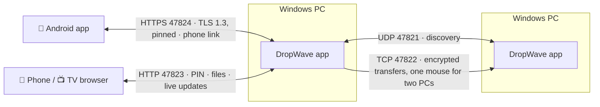

| Port | Used for |
|---|---|
| UDP **47821** | PCs announce themselves every 2 s, so PCs and the Android app find them automatically |
| TCP **47822** | PC-to-PC: signed X25519 handshake → AES-256-GCM → file list → accept → stream (resumable) → SHA-256 check |
| HTTP **47823** | The phone/TV page: PIN login, uploads, downloads with range support, Server-Sent Events, **Play now** streams |
| HTTPS **47824** | The Android app: the same, over TLS 1.3 with the PC's certificate pinned |

## 🧑‍💻 Build from source

```bash
git clone https://github.com/lalitaryan1993/dropwave.git
cd dropwave
npm install
npm run dev        # run with hot reload
npm test           # headless tests: PC transfers, phone/TV access, one mouse for two PCs
npm run dist       # build release/DropWave-Setup-x.y.z.exe
```

| Path | What's inside |
|---|---|
| `electron/engine.cjs` | PC discovery and transfer protocol (pure Node, unit-tested) |
| `electron/webshare.cjs` + `electron/web/` | Phone/TV server and the phone page (also used inside the Android app) |
| `electron/phone.cjs` | The phone link: notifications, calls, SMS, photos, controls, webcam |
| `electron/flow.cjs` + `native/kvm/` | One mouse and keyboard for two PCs, clipboard and files with it (C++ helper `dwkvm.exe`) |
| `electron/docs.cjs` + `src/docs.jsx` | Print on PC and Scan to PC: pages, editing, printing, PDF / JPG / PNG |
| `electron/main.cjs` | Windows, tray, notifications, settings, the DropWave Camera manager |
| `src/` | Desktop UI (React, Tailwind, Motion) |
| `native/vcam/` | DropWave Camera, a Windows 11 virtual camera (C++, Media Foundation) |
| `mobile/` | Android app (Capacitor + Kotlin) |
| `test/` | `engine.test.cjs`, `web.test.cjs`, `flow.test.cjs` |

**Android build** (JDK 21 + Android SDK): `cd mobile && npm install && npm run apk` → `mobile/android/app/build/outputs/apk/release/`. Release signing reads `%USERPROFILE%\.dropwave\keystore.properties`.

## 🗺️ Roadmap

- [x] Encrypted, resumable PC-to-PC transfers; phones and TVs from the browser
- [x] Android app: share, notifications, calls, SMS, photos, files, screen with mouse and keyboard
- [x] Phone as webcam (and a Windows 11 camera), contacts, apps, phone controls, styles
- [x] Call popup with mute and speaker, Hindi, auto-discovery
- [x] Each phone app in its own window on the PC
- [x] The phone's microphone as the PC's microphone (with the free VB-CABLE for other apps)
- [x] Print from the phone on the PC's printer; scan documents to PDF / JPG / PNG
- [x] One mouse and keyboard for two PCs, with copy and paste of files
- [ ] macOS & Linux builds
- [ ] Code-signed installer / Microsoft Store (removes the SmartScreen warning)

Ideas and bug reports are welcome: [open an issue](https://github.com/lalitaryan1993/dropwave/issues). If DropWave saves you a few phone pickups a day, a ⭐ helps others find it.

## License

[MIT](LICENSE) © LALIT ARYAN. App icon and installer artwork were generated with ChatGPT.
