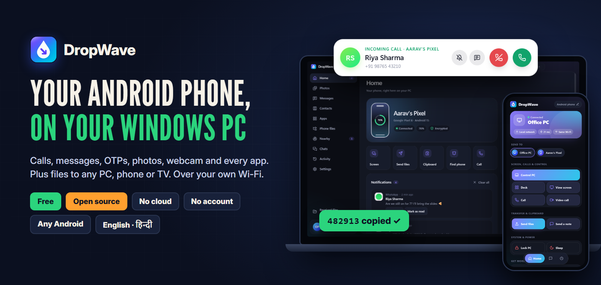
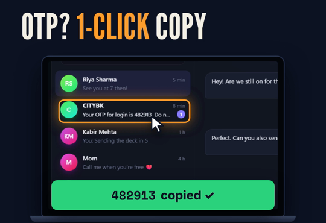
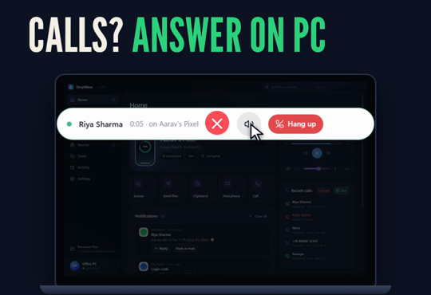
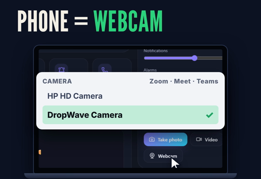
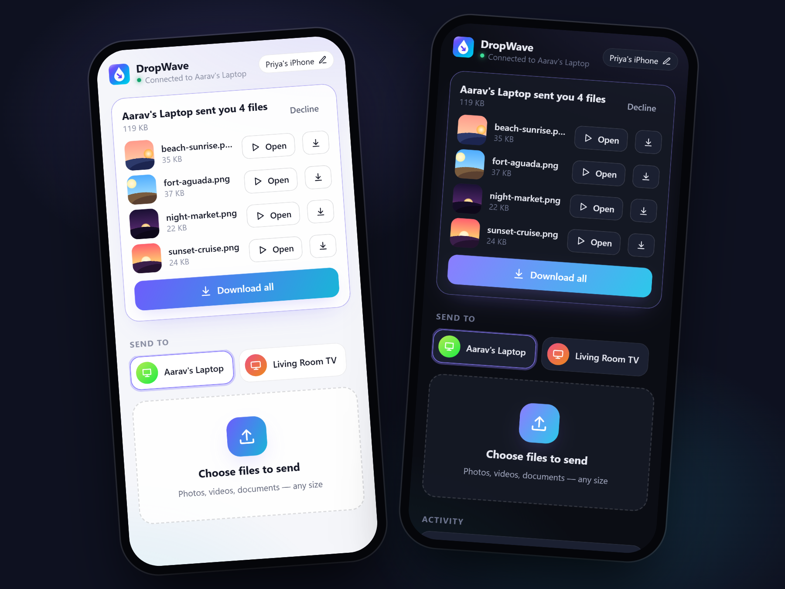
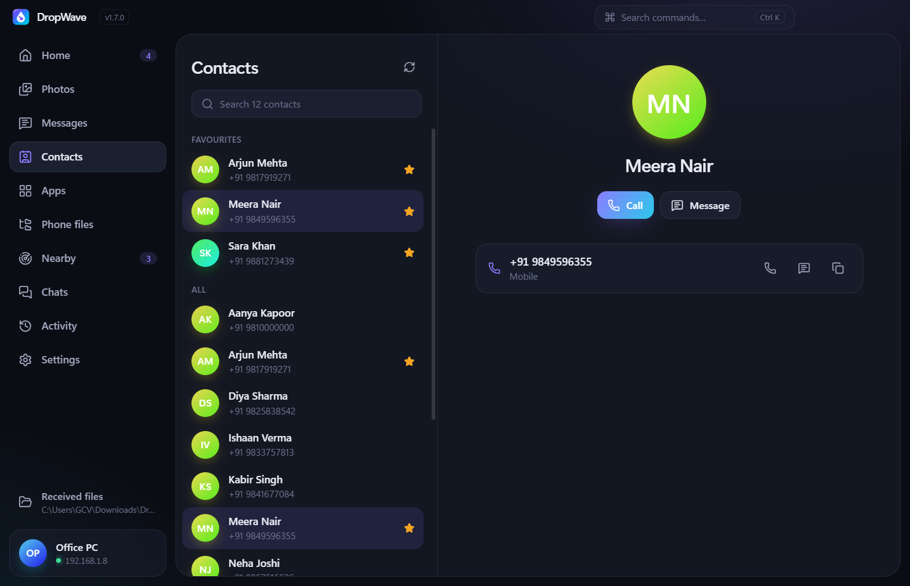
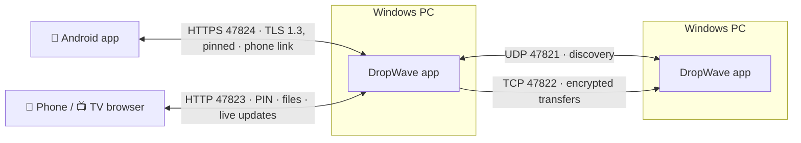

<div align="center">



<br />

### Stop picking up your phone. 📵

**Calls, WhatsApp & SMS, OTPs, photos, the camera as a webcam and every app, right on your Windows PC.<br />Plus files to any PC, phone or TV. All over your own Wi-Fi: no cloud, no account, no cables.**

<br />

[](https://github.com/lalitaryan1993/dropwave/releases/latest)
&nbsp;
[](https://github.com/lalitaryan1993/dropwave/releases/latest)

[](https://github.com/lalitaryan1993/dropwave/releases)
[](https://github.com/lalitaryan1993/dropwave/releases)
[](https://github.com/lalitaryan1993/dropwave/stargazers)
[](LICENSE)


<br />


<sub>Real DropWave screens with a demo phone (made-up names and numbers)</sub>

</div>

---

## ✨ Everything your phone does, on your PC

<table>
<tr>
<td width="33%" valign="top"><br /><b>💬 Messages</b><br />WhatsApp and other notifications with <b>Reply</b>, and your SMS conversations. Read and answer from the keyboard.</td>
<td width="33%" valign="top"><br /><b>🔢 OTP in one click</b><br />A bank code arrives, you press <b>Copy code</b>. The phone stays in your pocket.</td>
<td width="33%" valign="top"><br /><b>📞 Calls</b><br />A popup on top of everything: <b>Answer</b>, <b>Decline</b>, <b>Silence</b>, reply with a message, then <b>Mute</b> and <b>Speaker</b>. SIM and WhatsApp calls.</td>
</tr>
<tr>
<td width="33%" valign="top"><br /><b>🖼️ Photos ↔ files</b><br />The camera roll on the PC, phone storage, drag & drop both ways and <b>photo auto-backup</b>. Originals, at Wi-Fi speed.</td>
<td width="33%" valign="top"><br /><b>📷 Phone = webcam</b><br />Pick <b>DropWave Camera</b> in Zoom, Meet or Teams (Windows 11). Front or back camera, torch, mirror.</td>
<td width="33%" valign="top"><br /><b>📱 Apps & contacts</b><br />Every app with its icon (open, info, uninstall, copy APK, recent and most used), contacts and call history.</td>
</tr>
<tr>
<td width="33%" valign="top"><br /><b>🔦 Phone controls</b><br />Torch, Do Not Disturb, volumes, brightness, lock. Lost it under the sofa? <b>Find phone</b> rings it, even on silent.</td>
<td width="33%" valign="top"><br /><b>⌨️ Ctrl + K</b><br />One search box for everything: send a file, call, message, find the phone, switch theme or language.</td>
<td width="33%" valign="top"><br /><b>🔒 Stays on your Wi-Fi</b><br />Scan a QR code once. No cloud, no account, no login. Encrypted, and a switch for every feature on the phone.</td>
</tr>
</table>

**And more:** the phone's screen in a window with mouse and keyboard control · clipboard both ways (and a *Send clipboard* tile on the phone) · music and volume · the phone as a touchpad and shortcut Deck for the PC · works while the phone is locked · **Hindi** and English · five styles in light and dark.

<p align="center">
  <br />
  <sub><b>Safe by default:</b> when a bank or UPI app opens on the phone, control from the PC switches itself off.</sub>
</p>

## 🚀 Get started in 2 minutes

1. **PC:** download **`DropWave-Setup-x.y.z.exe`** from the [latest release](https://github.com/lalitaryan1993/dropwave/releases/latest) and run it.<br />
   <sub>Windows may say *"Windows protected your PC"* because the app isn't code-signed yet: **More info → Run anyway**.</sub>
2. **Phone:** install **`DropWave-Android-x.y.z.apk`** from the same release (Android 10+). It finds your PC on the Wi-Fi by itself; enter the PIN shown on the PC once.
3. On the phone, open **Privacy** and turn on what you want to share. Android asks once for each permission. That's it.

> Phone and PC must be on the **same Wi-Fi**. No internet is needed. iPhones and smart TVs can still send and receive files from the browser, no install (see below).

## 🆕 New in 1.8.1

- **📞 Call popup on the PC** with Answer, Decline, Silence, quick replies, Mute, Speaker and Hang up, for SIM and WhatsApp calls.
- **🇮🇳 Hindi**: the PC app and the phone app in Hindi (*Settings › Appearance › Language*, or Ctrl+K).
- **📋 Send clipboard tile** on the phone's Quick Settings, **drag & drop** onto the phone-screen window, **Recent apps** on the PC.
- **📡 Finds the PC by itself**, instantly, and follows it when the router gives it a new address. Battery steps for Realme, Oppo, Vivo, Xiaomi, Samsung and OnePlus.
- **Fixes**: no more *Send to device* bubble on Android 13+, no more clipboard error dialog.

<sub>1.8: phone as webcam and *DropWave Camera*, contacts, apps, phone controls, styles, works while locked, privacy tab. [All releases →](https://github.com/lalitaryan1993/dropwave/releases)</sub>

## 🤔 Why DropWave?

|  | DropWave | Cloud drives / chat apps | USB cable / pen drive |
|---|:---:|:---:|:---:|
| Calls, messages and OTPs on the PC | ✅ | ❌ | ❌ |
| Works without internet | ✅ | ❌ | ✅ |
| Original quality, any file size | ✅ | ❌ compressed / size caps | ✅ |
| Phones & TVs without installing anything | ✅ | ⚠️ app needed | ❌ |
| Your data stays at home | ✅ | ❌ | ✅ |
| Free and open source | ✅ | ⚠️ | ✅ |

## 📤 Send files to every device

DropWave started as the fastest way to move files around the house, and that is still here.

<table>
<tr>
<td width="50%" valign="top">

- **PC ↔ PC drag & drop**: PCs on the network find each other. Drop files **or whole folders** on a device card.
- **Phones, iPhones, tablets & TVs, no app**: click **Phone or TV**, scan the QR code, done.
- **▶️ Play now**: watch a 4 GB video **before** accepting it, streamed from the sender, with seeking.
- **Always asks first**: Accept / Decline with the file list, or *Always accept* for your own devices.

</td>
<td width="50%" valign="top">

- **🔒 Encrypted & resumable**: PC-to-PC is end-to-end encrypted (X25519 + AES-256-GCM); the Android app uses TLS 1.3 with a pinned certificate. Wi-Fi dropped? It resumes. SHA-256 verified.
- **💬 Chat, calls & screen sharing** between PCs and phones, and **remote control** with the other side's **Allow**.
- **Right-click → Send with DropWave** in File Explorer, a one-click **network check**, and **auto-update**.

</td>
</tr>
</table>

<p align="center">
  
  
</p>

<details>
<summary><b>📸 More screenshots</b></summary>
<br />

<table>
<tr>
<td width="50%"><br /><sub>Home: battery, music, notifications with Reply and Copy code, recent calls</sub></td>
<td width="50%"><br /><sub>Messages: SMS conversations on the PC</sub></td>
</tr>
<tr>
<td width="50%"><br /><sub>Apps: open, window, APK, info, uninstall</sub></td>
<td width="50%"><br /><sub>Contacts: search, call, message</sub></td>
</tr>
<tr>
<td width="50%"><br /><sub>Photos: the camera roll by day</sub></td>
<td width="50%"><br /><sub>Phone files: browse and copy to the PC</sub></td>
</tr>
<tr>
<td width="50%"><br /><sub>Screen sharing with control, mic and full screen</sub></td>
<td width="50%"><br /><sub>Play now: watch before you accept</sub></td>
</tr>
<tr>
<td width="50%"><br /><sub>On a smart TV: big, remote-friendly buttons</sub></td>
<td width="50%"><br /><sub>The Android app: Control PC, Deck, calls, send files</sub></td>
</tr>
</table>

<p align="center">
  
  
  
</p>

</details>

## ❓ FAQ

<details>
<summary><b>Is it really free? What's the catch?</b></summary>
It's free and open source under the MIT licence. There is no server, so there is nothing to pay for and nothing that sees your data.
</details>

<details>
<summary><b>Which phones work?</b></summary>
Any Android 10+ phone, any brand. Some brands (Realme, Oppo, Vivo, Xiaomi, Samsung, OnePlus) stop apps in the background; the phone app shows the one setting to allow for your brand. iPhones can send and receive files from the browser.
</details>

<details>
<summary><b>Can I talk on a call through the PC's headphones?</b></summary>
Not yet. You answer, mute and hang up from the PC, but the voice stays on the phone: Android doesn't let apps carry call audio.
</details>

<details>
<summary><b>Is it safe? Can others on my Wi-Fi get in?</b></summary>
Every device needs your PIN once, and every file asks <b>Accept</b> first. PC-to-PC traffic is end-to-end encrypted (a fresh X25519 key exchange per connection, AES-256-GCM, each PC's Ed25519 identity pinned). The Android app talks to the PC over TLS 1.3 and pins the PC's certificate. The phone has a switch for every feature, and control from the PC turns itself off when a bank or UPI app opens. The no-install browser page (TVs, iPhones) uses plain HTTP on your local network, so use it on networks you trust.
</details>

<details>
<summary><b>Do I need internet? Is there a file-size limit?</b></summary>
No internet needed: it works on a router with no internet or on a phone hotspot. No size limit either: files stream straight to disk, so 50 GB works like 2 KB.
</details>

<details>
<summary><b>A device doesn't show up. What now?</b></summary>
Check both are on the same Wi-Fi (guest networks often keep devices apart) and that Windows calls the network <i>Private</i>. DropWave's network check fixes the usual causes in one click, and <b>Add by IP</b> always works.
</details>

<details>
<summary><b>Where do received files go? Mac or Linux?</b></summary>
<code>Downloads\DropWave</code>, changeable in Settings. The desktop app is Windows-only today; Macs and Linux PCs can join as a browser device. Native builds are on the roadmap.
</details>

## 🛠️ How it works



| Port | Used for |
|---|---|
| UDP **47821** | PCs announce themselves every 2 s, so PCs and the Android app find them automatically |
| TCP **47822** | PC-to-PC: signed X25519 handshake → AES-256-GCM → file list → accept → stream (resumable) → SHA-256 check |
| HTTP **47823** | The phone/TV page: PIN login, uploads, downloads with range support, Server-Sent Events, **Play now** streams |
| HTTPS **47824** | The Android app: the same, over TLS 1.3 with the PC's certificate pinned |

## 🧑‍💻 Build from source

```bash
git clone https://github.com/lalitaryan1993/dropwave.git
cd dropwave
npm install
npm run dev        # run with hot reload
npm test           # headless tests: PC transfers + phone/TV access
npm run dist       # build release/DropWave-Setup-x.y.z.exe
```

| Path | What's inside |
|---|---|
| `electron/engine.cjs` | PC discovery and transfer protocol (pure Node, unit-tested) |
| `electron/webshare.cjs` + `electron/web/` | Phone/TV server and the phone page (also used inside the Android app) |
| `electron/phone.cjs` | The phone link: notifications, calls, SMS, photos, controls, webcam |
| `electron/main.cjs` | Windows, tray, notifications, settings, the DropWave Camera manager |
| `src/` | Desktop UI (React, Tailwind, Motion) |
| `native/vcam/` | DropWave Camera, a Windows 11 virtual camera (C++, Media Foundation) |
| `mobile/` | Android app (Capacitor + Kotlin) |
| `test/` | `engine.test.cjs`, `web.test.cjs` |

**Android build** (JDK 21 + Android SDK): `cd mobile && npm install && npm run apk` → `mobile/android/app/build/outputs/apk/release/`. Release signing reads `%USERPROFILE%\.dropwave\keystore.properties`.

## 🗺️ Roadmap

- [x] Encrypted, resumable PC-to-PC transfers; phones and TVs from the browser
- [x] Android app: share, notifications, calls, SMS, photos, files, screen with mouse and keyboard
- [x] Phone as webcam (and a Windows 11 camera), contacts, apps, phone controls, styles
- [x] Call popup with mute and speaker, Hindi, auto-discovery
- [ ] Each phone app in its own window on the PC
- [ ] The phone's microphone as the PC's microphone
- [ ] macOS & Linux builds
- [ ] Code-signed installer / Microsoft Store (removes the SmartScreen warning)

Ideas and bug reports are welcome: [open an issue](https://github.com/lalitaryan1993/dropwave/issues). If DropWave saves you a few phone pickups a day, a ⭐ helps others find it.

## License

[MIT](LICENSE) © LALIT ARYAN. App icon and installer artwork were generated with ChatGPT.
