<div align="center">


<br />

**Send files between PCs, phones and smart TVs on your Wi-Fi.<br />Drag & drop on Windows. Scan a QR code on everything else. No cloud, no cables, no size limits.**

<br />

[](https://github.com/lalitaryan1993/dropwave/releases/latest)

[](https://github.com/lalitaryan1993/dropwave/releases)
[](https://github.com/lalitaryan1993/dropwave/releases)
[](LICENSE)


</div>

---

## Why DropWave?

Moving a video from your laptop to the TV, or photos from your phone to the PC, still means
cables, pen drives, WhatsApp-compressed copies or a slow upload to the cloud and back.

**DropWave sends files straight across your own Wi-Fi.** Files never leave your home or office,
they keep their full quality, and they move at network speed: tens of MB/s on a normal router.

|  | DropWave | Cloud drives / chat apps | USB / pen drive |
|---|:---:|:---:|:---:|
| Works without internet | ✅ | ❌ | ✅ |
| Original quality, any size | ✅ | ❌ compressed / size caps | ✅ |
| Phones & TVs, no app install | ✅ | ⚠️ app needed | ❌ |
| Files stay on your network | ✅ | ❌ | ✅ |
| Speed | ⚡ LAN speed | 🐢 upload + download | 🚶 walk over |

## Features

<table>
<tr>
<td width="50%" valign="top">

### 🖱️ Drag & drop between PCs
PCs on the same network find each other automatically. Drop files **or whole folders**
on a device card, and that's it.

### ✋ You stay in control
The receiver gets an **Accept / Decline** prompt with the file list. Tick
*"Always accept"* for your own devices.

### 📱 Phones, tablets & TVs, no app
Click **Phone or TV**, scan the QR code, done. Runs in any modern browser, on phones,
tablets and smart TVs alike.

</td>
<td width="50%" valign="top">

### ▶️ Play now: stream, don't wait
Got a 4 GB video from another PC? Hit **Play** in the Accept dialog and it starts
**instantly**, with seeking, while you decide whether to keep it. It also works while it's copying,
and on phones and TVs right in the browser.

### 🔁 Phone ↔ phone, phone ↔ TV
Any connected browser can send to any other (relayed through the PC).

### 🔒 Encrypted & reliable
PC-to-PC transfers are **end-to-end encrypted** (X25519 + AES-256-GCM, device identities pinned),
and the **Android app talks to your PC over TLS 1.3** with the PC's certificate pinned.
Wi-Fi dropped? Transfers **resume where they stopped**. SHA-256 verified, no overwrites.

</td>
</tr>
<tr>
<td width="50%" valign="top">

### 💬 Chat with any device
A conversation per device, between PCs, phones and TVs. Send links, notes or your clipboard;
links open with one click, messages are kept, and unread badges show what's new.

### 📞 Calls, screen sharing & remote control
Voice and video calls between PCs and phones. Share your screen, or ask to see another PC's screen,
and talk while you work. With the other side's **Allow**, drive its mouse and keyboard, from another PC
or from your phone (full-screen, landscape; tap, drag, scroll and type). The person sharing always sees
who is in control and can press **Stop**. Everything goes device to device on your Wi-Fi.

<p align="center">
<br />
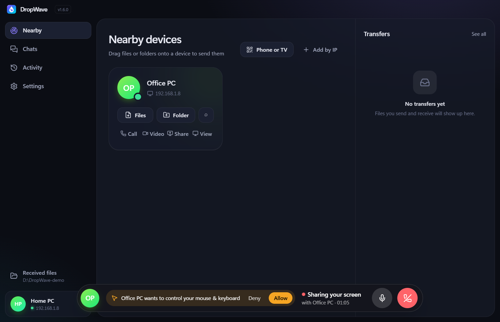
</p>

### 🖱️ Right-click → Send with DropWave
Send files and folders straight from File Explorer, without opening the app first.

</td>
<td width="50%" valign="top">

### 🩺 One-click network check
"Can't see my other PC?" DropWave finds the usual causes (Public network, firewall block)
and fixes them with one click.

### 🔄 Auto-update
New versions download in the background. Restart when you like.

</td>
</tr>
</table>

<div align="center">
  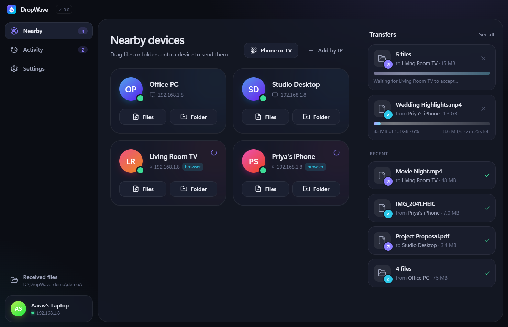
  <br /><sub>Nearby devices: PCs, a phone and a TV, with live transfers on the right</sub>
</div>

## New in 1.8: webcam, contacts, apps and styles

<div align="center">
  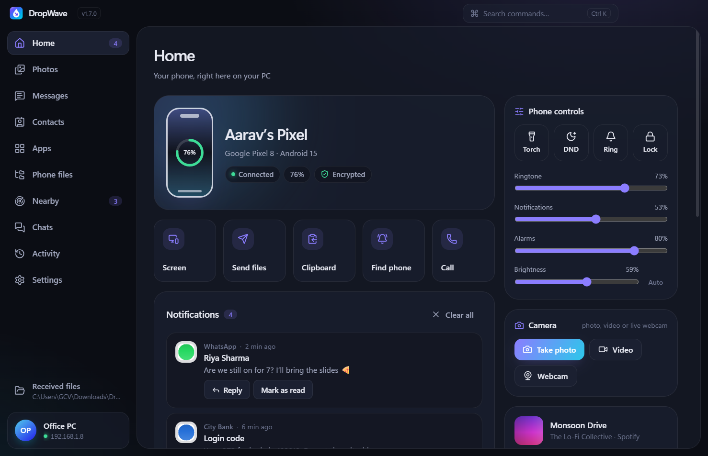
</div>

- **Phone as webcam**: the phone's camera live in a window (front / back, mirror, rotate, torch, snapshot, clean view). On Windows 11 it also appears as **DropWave Camera** in Zoom, Meet, Teams and the Camera app.
- **Camera for the PC**: *Take photo* on the PC opens the phone's camera; the photo lands on the PC **and in the clipboard**, ready for Ctrl+V. Video too.
- **Contacts**: search the phone's contacts, call (rings out from the phone), text or copy a number.
- **Apps**: every app on the phone with its icon: open it on the phone or in a window on the PC, app info, uninstall (the phone asks first), copy the APK.
- **Phone controls**: torch, Do Not Disturb, ring / vibrate, ringtone, notification and alarm volumes, brightness, lock.
- **Works while the phone is locked**: a native link in the Android app keeps answering the PC when the screen is off or another app is open. Allow *Keep working when the phone is locked* once.
- **Privacy tab on the phone**: a *Share with PC* switch for every feature, one *Pause sharing* switch, Android's own access for each (Allow / Turn off), and **Control from PC switches itself off** when a banking or UPI app opens.
- **Styles**: Aurora, Frost (see-through over the Windows 11 backdrop), Petal, Ink and Dots, each in light and dark.
- **Also**: the phone's sound while mirroring, and **photo auto-backup** to *Downloads\DropWave\Phone Backup* by year and month.

<p align="center">
  
  
</p>
<p align="center">
  
  
  
</p>

*(Screenshots use a demo phone with made-up names and numbers.)*

## Your phone on your PC (new in 1.7)

Connect the DropWave Android app and your phone is right there on the PC: no cloud, no account,
everything over your own Wi-Fi.

<div align="center">
  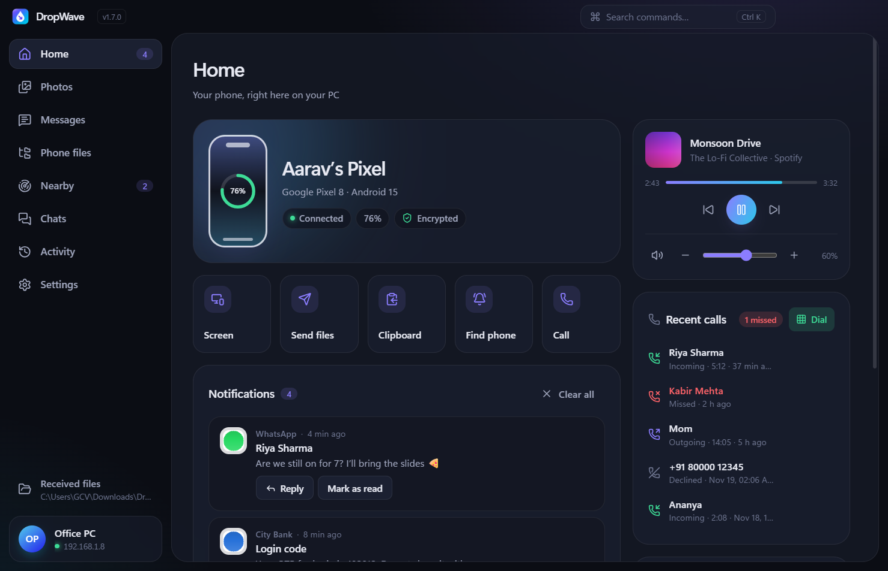
  <br /><sub>Home: battery, music and volume, notifications (reply, copy one-time codes), recent calls</sub>
</div>

| | |
|---|---|
| 🔔 **Notifications** | Reply, press the app's own buttons, dismiss, clear all. One-time codes get **Copy code**. New ones pop up on Windows too. |
| 📞 **Calls** | See who's calling, **Answer / Decline / Hang up** from the PC (WhatsApp, Telegram and Signal calls too), a **dial pad**, call back and recent calls. |
| 💬 **Messages** | Your SMS on the PC: conversations, replies and new messages, sent by the phone with its SIM. |
| 🖼️ **Photos** | The camera roll by day (photos, videos, screenshots). Pick some and **Download to PC**, originals with their own dates. |
| 📂 **Phone files** | Browse the phone's storage and copy files to the PC. |
| 📱 **Phone screen** | See the phone's screen in a window and use it with your **mouse and keyboard**: click, drag, scroll, type, Back/Home/Recents, screenshots. |
| 📋 **Clipboard** | Copy on one, paste on the other. Passwords from password managers are never sent. |
| 🎵 **Music & volume** | What's playing, play / pause / next / seek, and the phone's volume. |
| 🛎️ **Find my phone** | Rings at full volume, even on silent, until you tap *Found it*. |
| 🖱️ **Phone as touchpad** | **Control PC** turns the phone into a touchpad, keyboard and a **Deck** of shortcuts (media, volume, switch app, screenshot, slides, Lock, Sleep). The PC asks first and shows *"… is using your mouse · Stop"*. |

<table>
<tr>
<td width="50%"></td>
<td width="50%"></td>
</tr>
<tr>
<td width="50%"></td>
<td width="50%">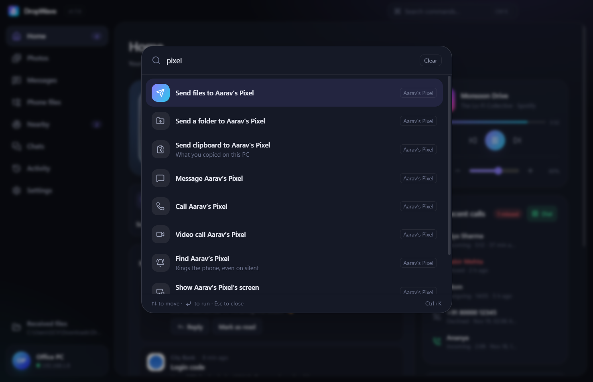</td>
</tr>
</table>

Also new on the PC: a **command palette** (<kbd>Ctrl</kbd>+<kbd>K</kbd>) for every action and device,
a **timeline** of what moved between devices, and five colour themes (Wave, Ocean, Sunset, Forest,
Graphite) in light and dark.

> **Permissions, only for what you use.** Each feature has its own card on the phone's Home
> (notification access, photos, calls, SMS, all-files access, Accessibility for screen control),
> and Android asks once. If Android says *"Restricted setting"* (APKs installed from a browser),
> open DropWave's **App info › ⋮ › Allow restricted settings** first. Nothing is stored on the PC
> unless you download it.

## Android app


Prefer an app over the browser? Install **`DropWave-Android-x.y.z.apk`** from the [latest release](https://github.com/lalitaryan1993/dropwave/releases/latest) (Android 10+).

- **Finds your PCs by itself.** It scans your Wi-Fi; enter the PC's PIN once and it's remembered.
- **Share → DropWave** from Gallery, Files, WhatsApp or Chrome sends photos, videos, files and links straight to a PC.
- Received files are saved to **Download/DropWave**, with the usual download notification.
- **Back** never disconnects: DropWave keeps running in the background.
- Same features as the browser version: chat, Play now for photos and videos, phone ↔ phone / TV.

> Android shows *"Install unknown apps"* the first time. Allow it for your browser or file manager, then open the APK.

## Phones & TVs (browser, no install)

<div align="center">
  
</div>

<br />

1. On the PC, click **Phone or TV**. A QR code and a 6-digit PIN appear.
2. Scan the code with the phone camera (or type the address + PIN on a TV).
3. The phone now shows up on the PC as a device. **Drag files onto it**, or send from the phone to the PC or to another phone or TV.

<div align="center">
  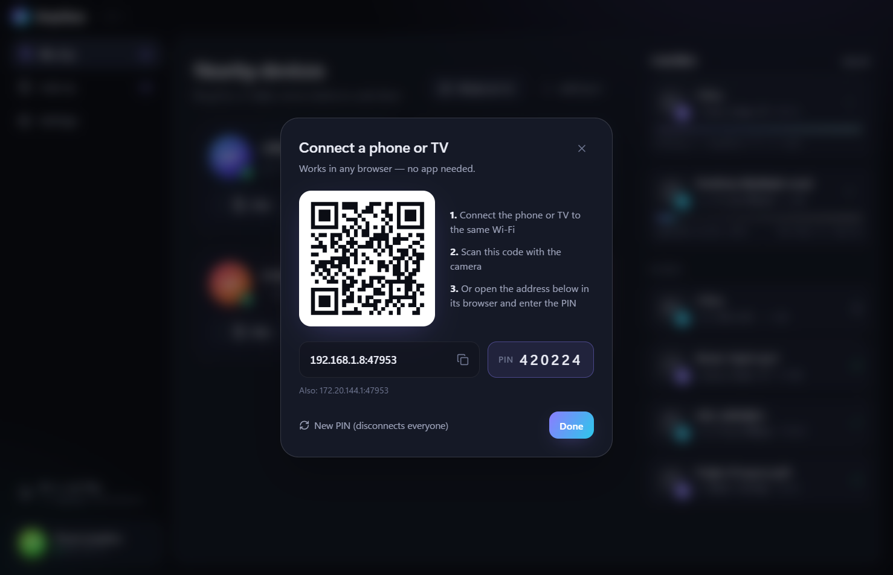
</div>

<table>
<tr>
<td width="50%"><br /><sub>On a smart TV: big, remote-friendly buttons</sub></td>
<td width="50%"><br /><sub>Open plays photos and videos full-screen, no download needed</sub></td>
</tr>
</table>

## More screenshots

<table>
<tr>
<td width="50%"><br /><sub><b>Play now</b>: watch a video before accepting it, streamed from the sender</sub></td>
<td width="50%">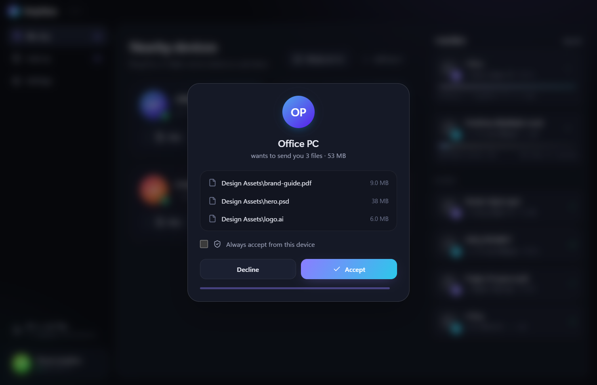<br /><sub>Incoming files always ask first</sub></td>
</tr>
<tr>
<td width="50%">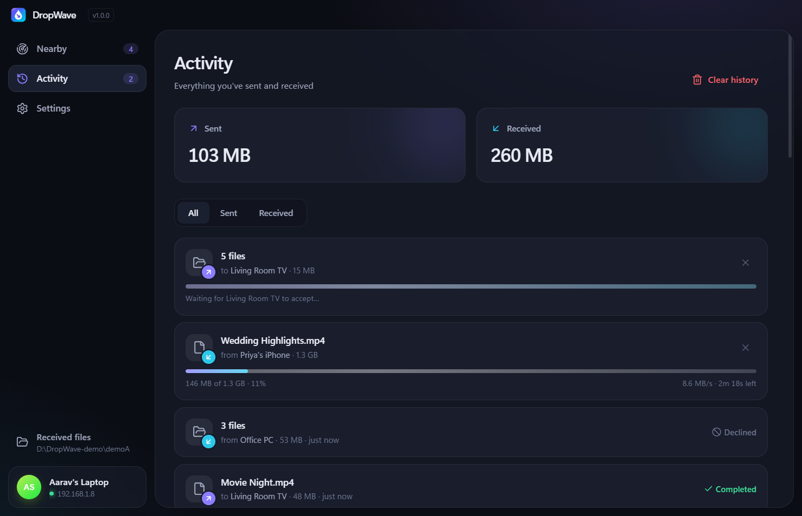<br /><sub>Live progress, speed, time left and history</sub></td>
<td width="50%">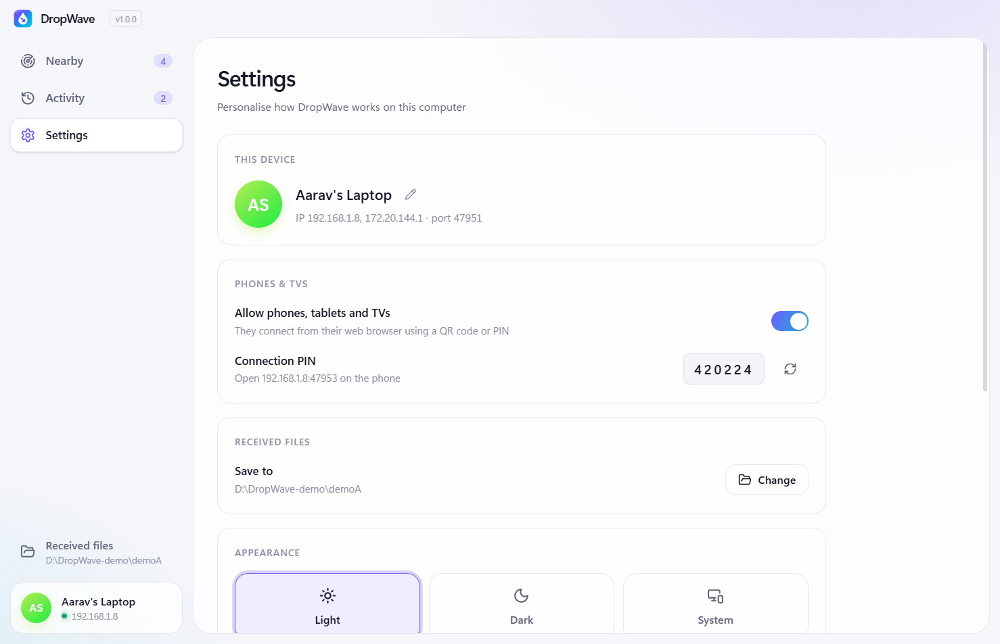<br /><sub>Settings: device name, PIN, save folder, theme, trusted devices</sub></td>
</tr>
<tr>
<td colspan="2" align="center">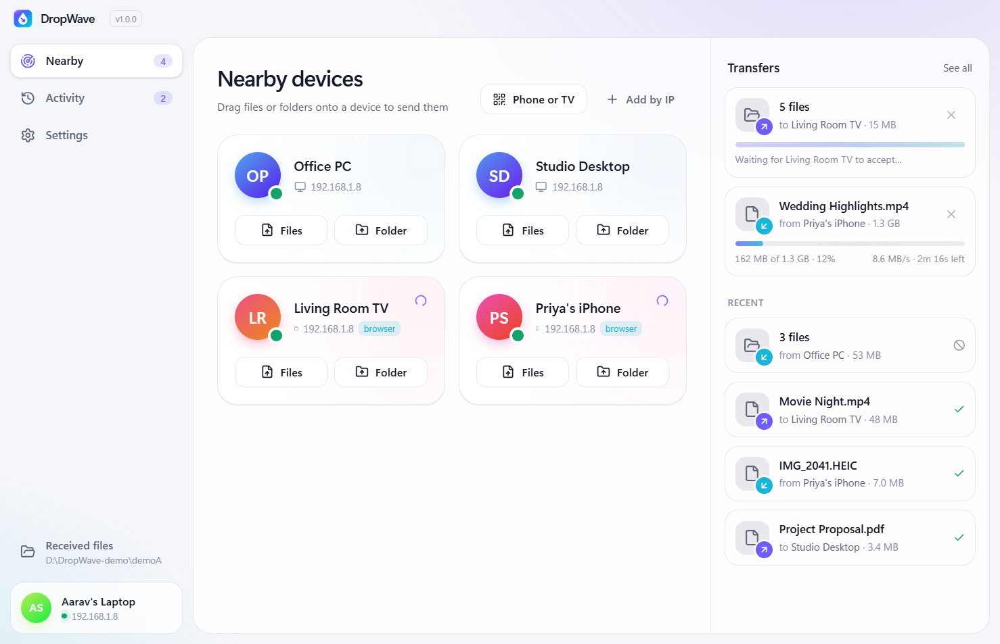<br /><sub>Light theme</sub></td>
</tr>
</table>

## Install

1. Download **`DropWave-Setup-x.y.z.exe`** from the [latest release](https://github.com/lalitaryan1993/dropwave/releases/latest).
2. Run it. Windows may say *"Windows protected your PC"* because the app isn't code-signed yet. Click **More info → Run anyway**.
3. Install DropWave on every PC you want to send between. Phones and TVs don't need anything.

> All devices must be on the **same Wi-Fi / LAN**. The installer adds a Windows Firewall rule
> for private networks, so devices can find each other.

## FAQ

<details>
<summary><b>Do I need internet?</b></summary>
No. DropWave only uses your local network. It works on a router with no internet, or on a phone hotspot.
</details>

<details>
<summary><b>Is there a file-size limit?</b></summary>
No. Files are streamed straight to disk, so 50 GB videos work the same as a 2 KB note.
</details>

<details>
<summary><b>A device doesn't show up. What now?</b></summary>
Check both devices are on the same Wi-Fi (guest networks often block devices from seeing each other), and that
the network is set to <i>Private</i> in Windows. You can always use <b>Add by IP</b>; each PC's IP is shown bottom-left.
</details>

<details>
<summary><b>Can someone on my Wi-Fi send me files without asking?</b></summary>
No. Every transfer, from a PC or a phone, needs you to press <b>Accept</b> (unless you trusted that device).
Browsers also need the 6-digit PIN, and <b>New PIN</b> instantly disconnects every phone and TV.
</details>

<details>
<summary><b>Is it encrypted? Can others on the network see my files?</b></summary>
PC-to-PC transfers and text are end-to-end encrypted: a fresh X25519 key exchange per connection, AES-256-GCM for
the data, and each PC's Ed25519 identity is remembered on first contact, so an impostor is refused. Compare the
<b>Security code</b> in Settings on both PCs to be sure.<br><br>
The <b>Android app</b> connects over HTTPS (TLS 1.3): each PC makes its own certificate, and the app remembers
(pins) it the first time you pair, then refuses any other certificate and never falls back to plain HTTP for that
PC. Your PIN, files, messages and video streams are encrypted. The <b>no-install browser page</b> (TVs, iPhones,
other phones) still uses plain HTTP on your local network, because browsers would show certificate warnings
otherwise, so use it on networks you trust.
</details>

<details>
<summary><b>What happens if the Wi-Fi drops in the middle of a big transfer?</b></summary>
The sender reconnects automatically and continues from where it stopped. Nothing is sent twice, and the file is
still checked end-to-end with SHA-256. The receiver keeps the partial file for 2 minutes.
</details>

<details>
<summary><b>How does "Play now" work? Which formats play?</b></summary>
The sending PC serves the file over your network through a secret, single-transfer link that expires after a
few hours, so the receiver can watch and seek without copying first. Anything Chromium plays works: MP4 (H.264),
WebM, MP3, M4A, WAV, common images. HEVC/H.265 videos may need to be accepted and opened in your usual player.
</details>

<details>
<summary><b>I pressed Back on my phone by mistake. Did it disconnect?</b></summary>
No. The first Back press only shows "Press Back again to leave". If you do leave, just open the address again:
you're reconnected without the PIN, and your chat is still there. Offers that were waiting for you come back too.
</details>

<details>
<summary><b>Where do received files go?</b></summary>
<code>Downloads\DropWave</code> by default. You can change it in Settings.
</details>

<details>
<summary><b>Does it work on Mac or Linux?</b></summary>
The desktop app is built and tested for Windows today. Macs and Linux PCs can already join as a
<b>browser device</b> (Phone or TV → open the address). Native builds are on the roadmap.
</details>

## How it works

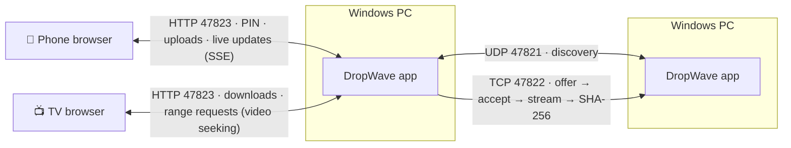

| Port | Used for |
|---|---|
| UDP **47821** | PCs announce themselves every 2 s, so they appear automatically |
| TCP **47822** | PC-to-PC: signed X25519 handshake → AES-256-GCM channel → file list → accept → stream (resumable) → SHA-256 check. Also text/clipboard |
| HTTP **47823** | The phone/TV page: PIN login (cookie), streaming uploads, downloads with range support, Server-Sent Events. Also serves PC-to-PC **Play now** streams at a secret per-transfer link |

## Build from source

```bash
git clone https://github.com/lalitaryan1993/dropwave.git
cd dropwave
npm install
npm run dev        # run with hot reload
npm test           # headless tests: PC transfers + phone/TV access
npm run dist       # build release/DropWave-Setup-x.y.z.exe
```

| Path | What's inside |
|---|---|
| `electron/engine.cjs` | PC discovery and transfer protocol (pure Node, unit-tested) |
| `electron/webshare.cjs` + `electron/web/` | Phone/TV server and the mobile web page |
| `electron/main.cjs` | Window, tray, notifications, settings |
| `src/` | Desktop UI (React, Tailwind, Motion) |
| `test/` | `engine.test.cjs`, `web.test.cjs` |
| `mobile/` | Android app (Capacitor). `www/index.html` = PC picker, `www/bridge.js` = native hooks, `android/.../DropWavePlugin.java` = downloads, share target, Back button. The phone page is copied in from `electron/web` at build time |

**Android build** (JDK 21 + Android SDK): `cd mobile && npm install && npm run apk` → `mobile/android/app/build/outputs/apk/release/`. Release signing reads `%USERPROFILE%\.dropwave\keystore.properties`.

## Roadmap

- [x] Chat and clipboard / link sharing
- [x] Auto-update
- [x] Encrypted, resumable PC-to-PC transfers
- [x] Explorer right-click "Send with DropWave"
- [x] Android app with Share → DropWave
- [x] Android: notifications with Download / Decline, stays connected in the background
- [x] Android: encrypted connection to the PC (TLS 1.3, pinned certificate)
- [x] Voice/video calls and screen sharing (PC ↔ PC, PC ↔ phone, phone ↔ phone)
- [x] Remote control of a Windows PC from another PC or a phone (with the owner's permission)
- [x] Phone on PC: notifications with replies, clipboard sync, battery, media, find my phone
- [x] Phone as touchpad, keyboard and Deck; command palette; colour themes
- [x] Photos, calls (and app calls), dial, SMS and phone files on the PC
- [x] Phone screen on the PC with mouse and keyboard control
- [x] Phone audio while mirroring, photo auto-backup
- [x] Phone as webcam (also as a Windows 11 camera), contacts, apps, phone controls, styles
- [ ] Phone microphone as the PC's microphone
- [ ] Reply from a notification on the PC; recent apps, each app in its own window
- [ ] Android: auto-discovery without scanning
- [ ] macOS & Linux builds
- [ ] Code-signed installer / Microsoft Store (removes the SmartScreen warning)
- [ ] Hindi and other languages

Ideas and bug reports are welcome. [Open an issue](https://github.com/lalitaryan1993/dropwave/issues).

## License

[MIT](LICENSE) © LALIT ARYAN. App icon and installer artwork were generated with ChatGPT.
