<div align="center">

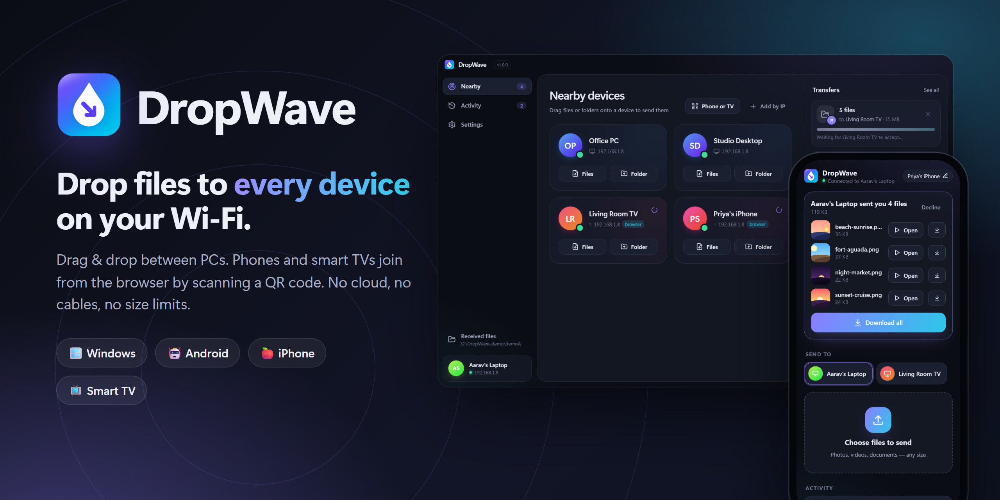

<br />

**Send files between PCs, phones and smart TVs on your Wi-Fi.<br />Drag & drop on Windows. Scan a QR code on everything else. No cloud, no cables, no size limits.**

<br />

[](https://github.com/lalitaryan1993/dropwave/releases/latest)

[](https://github.com/lalitaryan1993/dropwave/releases)
[](https://github.com/lalitaryan1993/dropwave/releases)
[](LICENSE)


</div>

---

## Why DropWave?

Moving a video from your laptop to the TV, or photos from your phone to the PC, still means
cables, pen drives, WhatsApp-compressed copies or a slow upload to the cloud and back.

**DropWave sends files straight across your own Wi-Fi.** Files never leave your home or office,
they keep their full quality, and they move at network speed: tens of MB/s on a normal router.

|  | DropWave | Cloud drives / chat apps | USB / pen drive |
|---|:---:|:---:|:---:|
| Works without internet | ✅ | ❌ | ✅ |
| Original quality, any size | ✅ | ❌ compressed / size caps | ✅ |
| Phones & TVs, no app install | ✅ | ⚠️ app needed | ❌ |
| Files stay on your network | ✅ | ❌ | ✅ |
| Speed | ⚡ LAN speed | 🐢 upload + download | 🚶 walk over |

## Features

<table>
<tr>
<td width="50%" valign="top">

### 🖱️ Drag & drop between PCs
PCs on the same network find each other automatically. Drop files **or whole folders**
on a device card, and that's it.

### ✋ You stay in control
The receiver gets an **Accept / Decline** prompt with the file list. Tick
*"Always accept"* for your own devices.

### 📱 Phones, tablets & TVs, no app
Click **Phone or TV**, scan the QR code, done. Runs in any modern browser, on phones,
tablets and smart TVs alike.

</td>
<td width="50%" valign="top">

### ▶️ Play now: stream, don't wait
Got a 4 GB video from another PC? Hit **Play** in the Accept dialog and it starts
**instantly**, with seeking, while you decide whether to keep it. It also works while it's copying,
and on phones and TVs right in the browser.

### 🔁 Phone ↔ phone, phone ↔ TV
Any connected browser can send to any other (relayed through the PC).

### 🔒 Encrypted & reliable
PC-to-PC transfers are **end-to-end encrypted** (X25519 + AES-256-GCM, device identities pinned).
Wi-Fi dropped? Transfers **resume where they stopped**. SHA-256 verified, no overwrites.

</td>
</tr>
<tr>
<td width="50%" valign="top">

### 📋 Send text & links
Share your clipboard, a link or a note with any PC, phone or TV. One click to **Copy** or **Open link**.

### 🖱️ Right-click → Send with DropWave
Send files and folders straight from File Explorer, without opening the app first.

</td>
<td width="50%" valign="top">

### 🩺 One-click network check
"Can't see my other PC?" DropWave finds the usual causes (Public network, firewall block)
and fixes them with one click.

### 🔄 Auto-update
New versions download in the background. Restart when you like.

</td>
</tr>
</table>

<div align="center">
  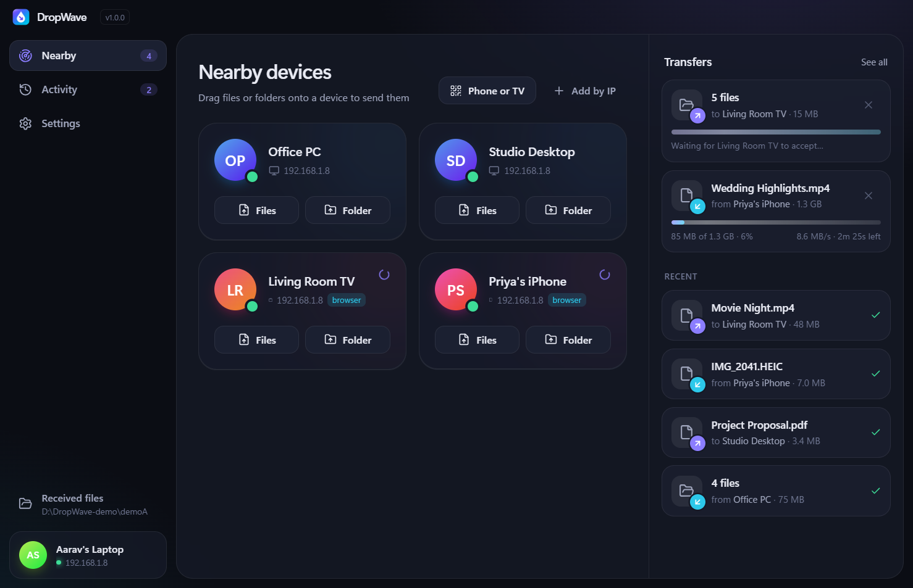
  <br /><sub>Nearby devices: PCs, a phone and a TV, with live transfers on the right</sub>
</div>

## Phones & TVs

<div align="center">
  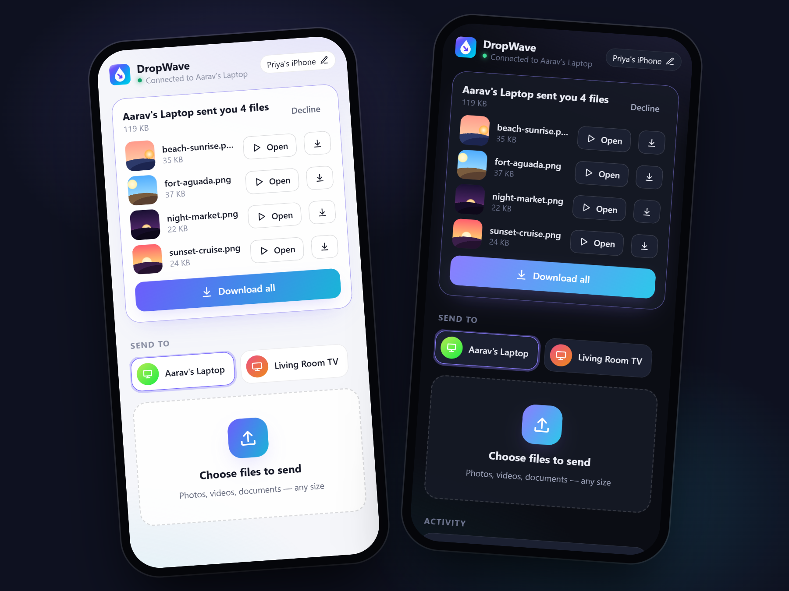
</div>

<br />

1. On the PC, click **Phone or TV**. A QR code and a 6-digit PIN appear.
2. Scan the code with the phone camera (or type the address + PIN on a TV).
3. The phone now shows up on the PC as a device. **Drag files onto it**, or send from the phone to the PC or to another phone or TV.

<div align="center">
  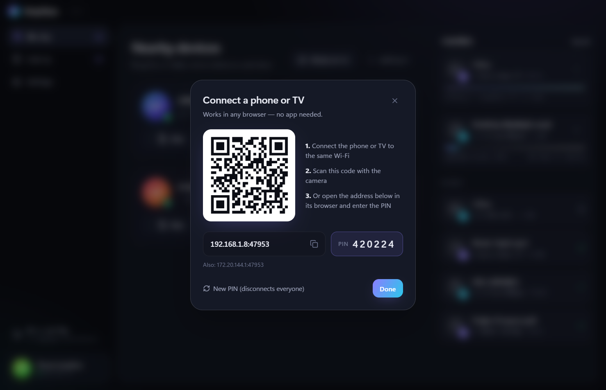
</div>

<table>
<tr>
<td width="50%">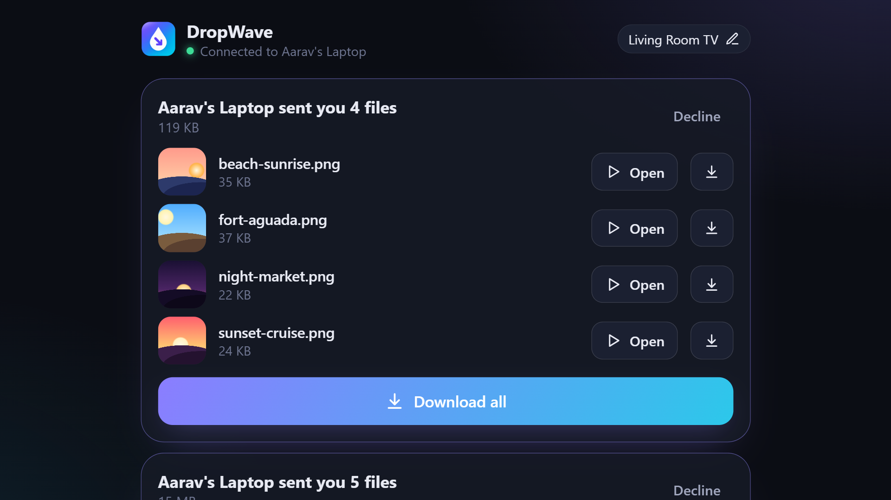<br /><sub>On a smart TV: big, remote-friendly buttons</sub></td>
<td width="50%"><br /><sub>Open plays photos and videos full-screen, no download needed</sub></td>
</tr>
</table>

## More screenshots

<table>
<tr>
<td width="50%">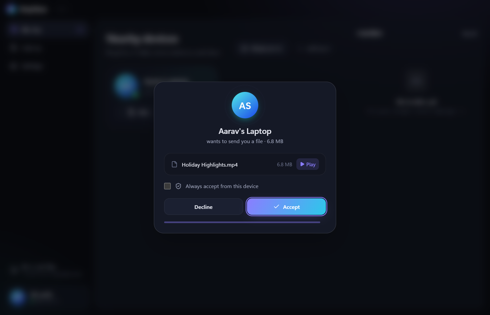<br /><sub><b>Play now</b>: watch a video before accepting it, streamed from the sender</sub></td>
<td width="50%">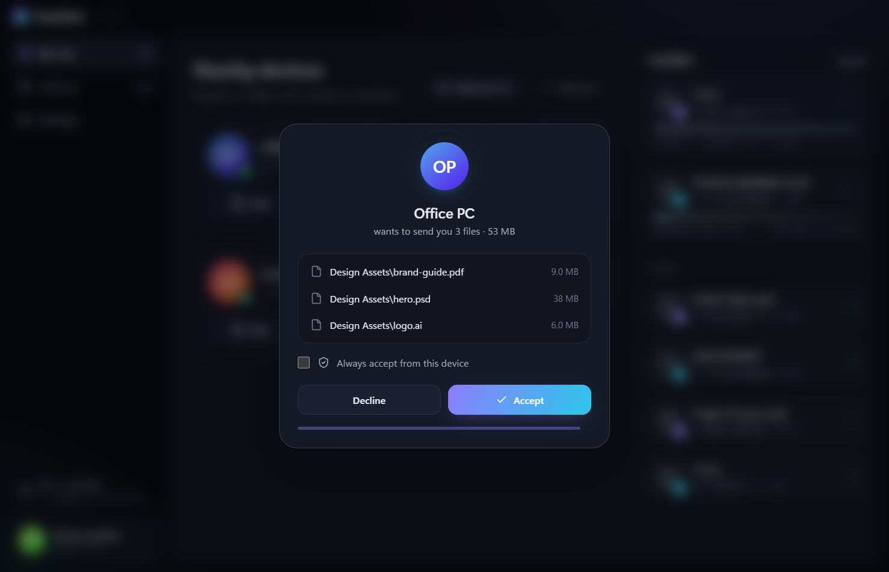<br /><sub>Incoming files always ask first</sub></td>
</tr>
<tr>
<td width="50%">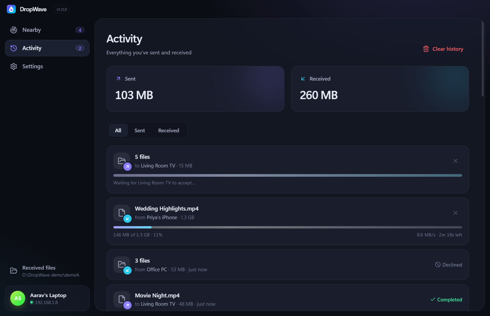<br /><sub>Live progress, speed, time left and history</sub></td>
<td width="50%">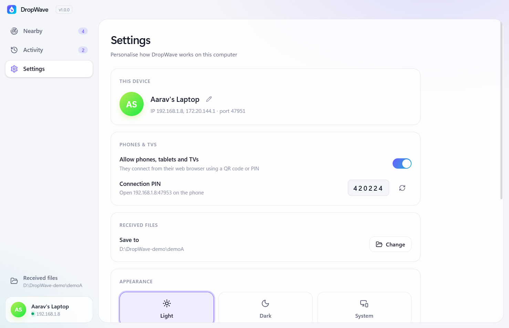<br /><sub>Settings: device name, PIN, save folder, theme, trusted devices</sub></td>
</tr>
<tr>
<td colspan="2" align="center">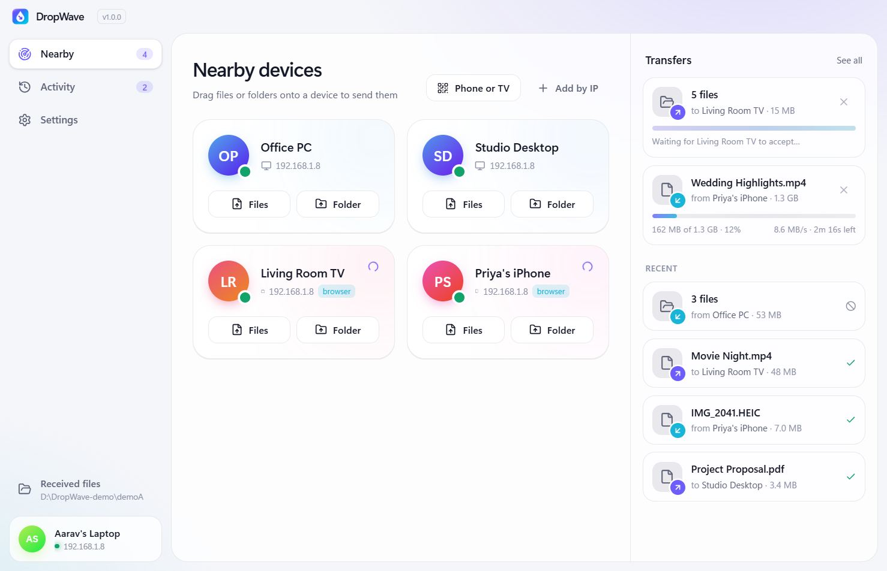<br /><sub>Light theme</sub></td>
</tr>
</table>

## Install

1. Download **`DropWave-Setup-x.y.z.exe`** from the [latest release](https://github.com/lalitaryan1993/dropwave/releases/latest).
2. Run it. Windows may say *"Windows protected your PC"* because the app isn't code-signed yet. Click **More info → Run anyway**.
3. Install DropWave on every PC you want to send between. Phones and TVs don't need anything.

> All devices must be on the **same Wi-Fi / LAN**. The installer adds a Windows Firewall rule
> for private networks, so devices can find each other.

## FAQ

<details>
<summary><b>Do I need internet?</b></summary>
No. DropWave only uses your local network. It works on a router with no internet, or on a phone hotspot.
</details>

<details>
<summary><b>Is there a file-size limit?</b></summary>
No. Files are streamed straight to disk, so 50 GB videos work the same as a 2 KB note.
</details>

<details>
<summary><b>A device doesn't show up. What now?</b></summary>
Check both devices are on the same Wi-Fi (guest networks often block devices from seeing each other), and that
the network is set to <i>Private</i> in Windows. You can always use <b>Add by IP</b>; each PC's IP is shown bottom-left.
</details>

<details>
<summary><b>Can someone on my Wi-Fi send me files without asking?</b></summary>
No. Every transfer, from a PC or a phone, needs you to press <b>Accept</b> (unless you trusted that device).
Browsers also need the 6-digit PIN, and <b>New PIN</b> instantly disconnects every phone and TV.
</details>

<details>
<summary><b>Is it encrypted? Can others on the network see my files?</b></summary>
PC-to-PC transfers and text are end-to-end encrypted: a fresh X25519 key exchange per connection, AES-256-GCM for
the data, and each PC's Ed25519 identity is remembered on first contact, so an impostor is refused. Compare the
<b>Security code</b> in Settings on both PCs to be sure. The phone/TV browser page uses plain HTTP on your local
network (browsers would show certificate warnings otherwise), so use it on networks you trust.
</details>

<details>
<summary><b>What happens if the Wi-Fi drops in the middle of a big transfer?</b></summary>
The sender reconnects automatically and continues from where it stopped. Nothing is sent twice, and the file is
still checked end-to-end with SHA-256. The receiver keeps the partial file for 2 minutes.
</details>

<details>
<summary><b>How does "Play now" work? Which formats play?</b></summary>
The sending PC serves the file over your network through a secret, single-transfer link that expires after a
few hours, so the receiver can watch and seek without copying first. Anything Chromium plays works: MP4 (H.264),
WebM, MP3, M4A, WAV, common images. HEVC/H.265 videos may need to be accepted and opened in your usual player.
</details>

<details>
<summary><b>Where do received files go?</b></summary>
<code>Downloads\DropWave</code> by default. You can change it in Settings.
</details>

<details>
<summary><b>Does it work on Mac or Linux?</b></summary>
The desktop app is built and tested for Windows today. Macs and Linux PCs can already join as a
<b>browser device</b> (Phone or TV → open the address). Native builds are on the roadmap.
</details>

## How it works

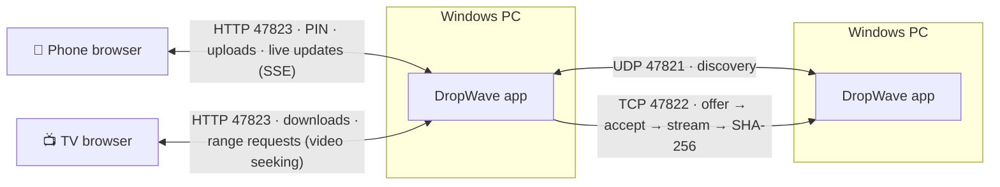

| Port | Used for |
|---|---|
| UDP **47821** | PCs announce themselves every 2 s, so they appear automatically |
| TCP **47822** | PC-to-PC: signed X25519 handshake → AES-256-GCM channel → file list → accept → stream (resumable) → SHA-256 check. Also text/clipboard |
| HTTP **47823** | The phone/TV page: PIN login (cookie), streaming uploads, downloads with range support, Server-Sent Events. Also serves PC-to-PC **Play now** streams at a secret per-transfer link |

## Build from source

```bash
git clone https://github.com/lalitaryan1993/dropwave.git
cd dropwave
npm install
npm run dev        # run with hot reload
npm test           # headless tests: PC transfers + phone/TV access
npm run dist       # build release/DropWave-Setup-x.y.z.exe
```

| Path | What's inside |
|---|---|
| `electron/engine.cjs` | PC discovery and transfer protocol (pure Node, unit-tested) |
| `electron/webshare.cjs` + `electron/web/` | Phone/TV server and the mobile web page |
| `electron/main.cjs` | Window, tray, notifications, settings |
| `src/` | Desktop UI (React, Tailwind, Motion) |
| `test/` | `engine.test.cjs`, `web.test.cjs` |

## Roadmap

- [x] Clipboard / text sharing
- [x] Auto-update
- [x] Encrypted, resumable PC-to-PC transfers
- [x] Explorer right-click "Send with DropWave"
- [ ] Android app (receive in the background, share-sheet integration)
- [ ] macOS & Linux builds
- [ ] Code-signed installer / Microsoft Store (removes the SmartScreen warning)
- [ ] Hindi and other languages

Ideas and bug reports are welcome. [Open an issue](https://github.com/lalitaryan1993/dropwave/issues).

## License

[MIT](LICENSE) © LALIT ARYAN. App icon and installer artwork were generated with ChatGPT.
